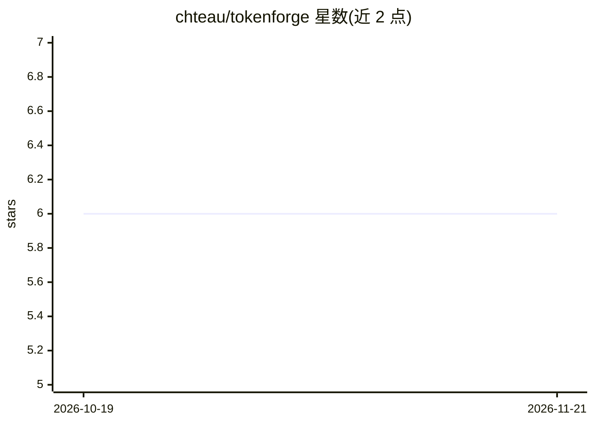

# chteau/tokenforge

⭐ 6 · Rust · MIT · 推送 2026-10-12 · [GitHub](https://github.com/chteau/tokenforge) · [官网](https://chteau.github.io/tokenforge/) · 个人维护

**为 Claude Code 用户降低会话 token 消耗的插件**

TokenForge 是一个 Claude Code 插件，通过改变工作组织方式减少每轮请求重复发送的上下文：先规划并生成契约（共享类型与签名）、任务计划，再由 `tforge` 以 `claude -p` 启动无 hooks、无 MCP 的临时 worker 执行各任务，由测试驱动判定完成，重试时升级到更强模型。`tforge meter` 按会话统计 token 去向。README 提供基于 37 个任务、24 个项目从零构建与既有代码库的基准数据。安装需 Claude Code 与 Node.js 18+；Codex 亦可接入部分 hooks。

## 筛选速览

| 维度 | 判定 | 备注 |
|---|---|---|
| AI 角色 | `ai-ecosystem` | LLM/agent 周边工具 |
| 许可风险 | `permissive` | MIT |
| 部署形态 | `desktop` | 安装包/桌面程序 |
| 模型依赖 | locked-api |  |
| 硬件要求 | — | 无带数字的原话,不猜 |
| 安装摩擦 | `medium` | 含编译或系统依赖之一 |
| 成熟度 | — | 结构信号不足 |

## 能力要点

- 用一次性 `claude -p` worker 执行任务，worker 仅含 Read/Write/Edit 工具
- 契约先行：共享类型、签名与每任务的 check 命令
- `tforge meter` 按会话统计 token 用量
- 支持 OpenAI Codex 运行同一套 hooks（部分功能受限）

## 适用场景

- 在 Claude Code 长会话中降低上下文重复发送带来的 token 消耗
- 在既有代码库上运行多任务构建并统计成本
- 对小型新建项目使用 `forge` 技能改为内联工作

## 场景标签

`编码 Agent` · 领域:编码与开发

## 证据(README 行号)

> L9:  Claude Code plugin Badge
> L22: Build big things with Claude Code for a fraction of the tokens.
> L27: - **Build with disposable workers.** `tforge` runs each task in a fresh, minimal `claude -p` worker. A worker has n
> L143: ## Install

## 星数曲线

2026-10-19 6 → 2026-11-21 6（+0）

---
*卡片 v1 · prompt 1.4 · 生成 2026-11-20 · 置信度 high · 依据 README sha `88f41f86ec74` · [字段定义](../../DATASET.md)*
