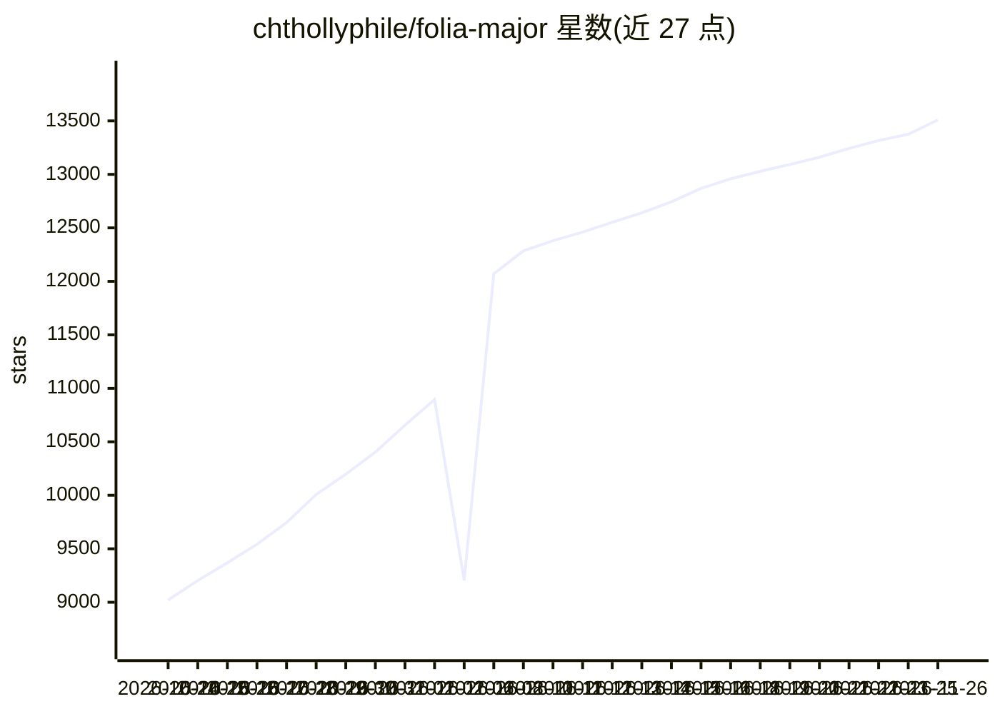

# chthollyphile/folia-major

⭐ 13,509 · TypeScript · AGPL-3.0 · 推送 2026-11-25 · [GitHub](https://github.com/chthollyphile/folia-major) · [官网](https://folia-site.cielaniska.top/) · 个人维护 · 中文 README

**歌词动画为核心的多平台音乐播放器，含 AI 配色主题**

以全屏沉浸式歌词播放为核心的在线音乐播放器，接入网易云、酷狗、QQ 音乐、Navidrome 与本地音乐库，桌面端另支持波点音乐、YouTube Music、Spotify、汽水音乐。提供 Electron 桌面安装包与 Node.js Web 版，可部署到 Vercel/Cloudflare 或以 Docker Compose 自托管。关键机制包括本地歌曲智能歌词匹配（按网易云、QQ、酷狗依次回退）、基于歌曲情绪与歌词内容的 AI 主题生成、多种可调参数的歌词动画，以及仅桌面版的 Folium 模组系统与可选的跨设备同步服务端。

## 筛选速览

| 维度 | 判定 | 备注 |
|---|---|---|
| AI 角色 | `ai-enhanced` | 去掉 AI 部分产品仍成立 |
| 许可风险 | `viral` | AGPL-3.0 |
| 部署形态 | `self-host` | docker 或自建部署 |
| 模型依赖 | — | README 未给出锁定关系 |
| 硬件要求 | — | 无带数字的原话,不猜 |
| 安装摩擦 | `low` | 无编译、无系统依赖或容器化 |
| 成熟度 | — | 结构信号不足 |

## 能力要点

- AI 主题生成：基于歌曲情绪与歌词内容生成沉浸式背景与视觉参数
- 自动匹配在线歌词与封面，支持 .lrc/.vtt/.ttml/.qrc/.yrc/.krc 本地歌词文件
- Folium 模组系统（仅桌面版）：歌词动画、音源等模组的应用内安装与签名机制
- 可选 sync-server 同步外观设置与 AI 主题库（Cloudflare Workers/Docker/Node.js）

## 适用场景

- 在桌面或浏览器全屏播放本地与在线音乐，配合歌词动画
- 本地音乐库自动匹配歌词封面并管理歌单与艺术家/专辑实体
- 通过 Navidrome 接入自托管音乐库
- 跨设备同步播放器外观与配色主题

## 场景标签

`图像生成` · 领域:内容生成

## 证据(README 行号)

> L30: Folia是一个以全屏沉浸式歌词播放为核心的在线音乐播放器，支持网易云、酷狗、QQ 音乐、Navidrome 和本地音乐库，桌面端还支持波点音乐、YouTube Music、Spotify 和汽水音乐，通过智能歌词匹配，AI生成配
> L104: |AI 主题生成|基于歌曲情绪与歌词内容生成沉浸式背景与视觉参数。|
> L106: |模组系统|桌面版可通过 Folium 模组添加歌词动画、背景、播放页图层、命令、音源等；模组市场就在「设置 → 模组」里，安装、更新、卸载都在应用内完成。详见 模组系统。|

## 星数曲线

2026-10-24 9,021 → 2026-11-26 13,509（+4,488）

---
*卡片 v1 · prompt 1.4 · 生成 2026-11-24 · 置信度 high · 依据 README sha `eeff65739671` · [字段定义](../../DATASET.md)*
