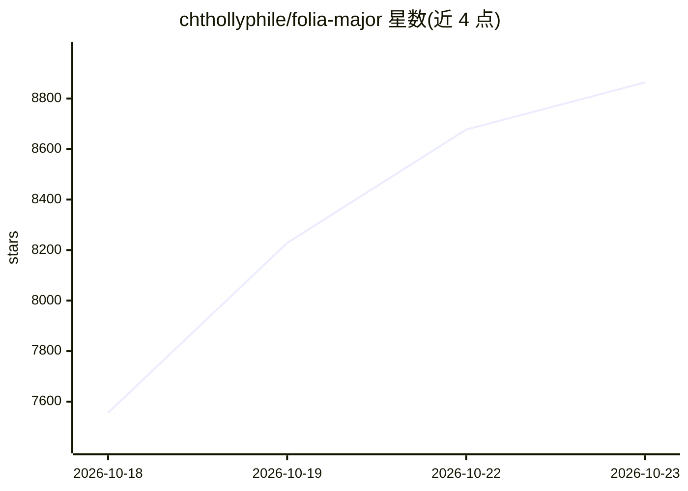

# chthollyphile/folia-major

⭐ 8,864 · TypeScript · AGPL-3.0 · 推送 2026-10-22 · [GitHub](https://github.com/chthollyphile/folia-major) · [官网](https://folia-site.cielaniska.top/) · 个人维护 · 中文 README

**以全屏沉浸式歌词动画为核心的多源音乐播放器**

在线/本地音乐播放器，支持网易云、酷狗、QQ 音乐、Navidrome 及本地音乐库，桌面端另支持波点音乐、YouTube Music 和 Spotify。核心特性为多种全屏歌词动画与响应式排版，本地歌曲可智能匹配在线歌词与封面，识别 .lrc/.ttml/.qrc 等多种歌词格式。AI 用于基于歌曲情绪与歌词内容生成配色主题。提供 Electron 桌面版（Windows/macOS/Linux 安装包）、Vercel/Cloudflare Web 部署、Docker Compose 自托管及 PWA；桌面版含实验性 Folium 模组系统与可选跨设备同步服务端。AGPL-3.0 开源，声明仅供学习与非营利测试使用。

## 筛选速览

| 维度 | 判定 | 备注 |
|---|---|---|
| AI 角色 | `ai-enhanced` | 去掉 AI 部分产品仍成立 |
| 许可风险 | `viral` | AGPL-3.0 |
| 部署形态 | `self-host` | docker 或自建部署 |
| 模型依赖 | — | README 未给出锁定关系 |
| 硬件要求 | — | 无带数字的原话,不猜 |
| 安装摩擦 | `low` | 无编译、无系统依赖或容器化 |
| 成熟度 | `idea` | |

## 能力要点

- 多种全屏歌词动画主题与响应式布局
- 智能歌词匹配与 .lrc/.vtt/.ttml/.qrc/.yrc/.krc 多格式本地歌词识别
- AI 基于歌曲情绪与歌词内容生成配色主题
- 桌面版 Folium 模组系统（实验性）与模组市场

## 适用场景

- 听歌时体验全屏沉浸式歌词动画
- 统一播放本地音乐库、Navidrome 与多个在线音源
- 本地歌曲自动匹配在线歌词与封面
- 自托管部署到 Vercel/Cloudflare/Docker 供多端使用

## 场景标签

 · 领域:音乐播放/桌面与Web应用

## 证据(README 行号)

> L30: Folia是一个以全屏沉浸式歌词播放为核心的在线音乐播放器，支持网易云、酷狗、QQ 音乐、Navidrome 和本地音乐库，桌面端还支持波点音乐、YouTube Music 和 Spotify，通过智能歌词匹配，AI生成配色主题，
> L97: |AI 主题生成|基于歌曲情绪与歌词内容生成沉浸式背景与视觉参数。|

## 星数曲线

2026-10-18 7,556 → 2026-10-23 8,864（+1,308）

---
*卡片 v1 · prompt 1.4 · 生成 2026-10-20 · 置信度 high · 依据 README sha `8a34ff7886a2` · [字段定义](../../DATASET.md)*
