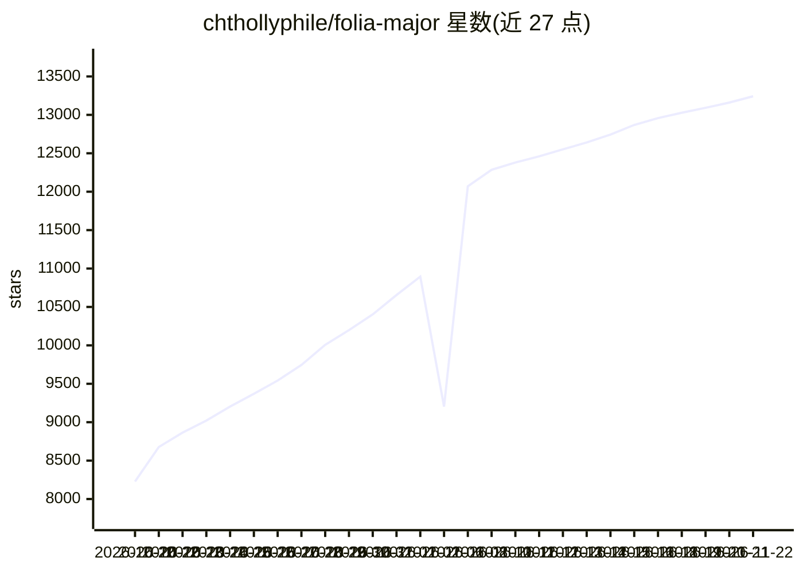

# chthollyphile/folia-major

⭐ 13,242 · TypeScript · AGPL-3.0 · 推送 2026-11-21 · [GitHub](https://github.com/chthollyphile/folia-major) · [官网](https://folia-site.cielaniska.top/) · 个人维护 · 中文 README

**面向音乐听众的全屏歌词动画播放器，支持本地/Navidrome/在线音源**

以全屏沉浸式歌词播放为核心的在线音乐播放器，接入网易云、酷狗、QQ 音乐、Navidrome 与本地音乐库，桌面端另支持波点音乐、YouTube Music、Spotify、汽水音乐。机制上通过智能歌词匹配自动补全歌词与封面，按歌曲情绪与歌词内容生成背景主题，多种歌词动画带可调参数与响应式布局。提供 Electron 桌面安装包与 Node.js Web 版（可部署至 Vercel/Cloudflare/Docker），模组系统与 Sync Server 为实验性/可选功能。

## 筛选速览

| 维度 | 判定 | 备注 |
|---|---|---|
| AI 角色 | `ai-enhanced` | 去掉 AI 部分产品仍成立 |
| 许可风险 | `viral` | AGPL-3.0 |
| 部署形态 | `self-host` | docker 或自建部署 |
| 模型依赖 | — | README 未给出锁定关系 |
| 硬件要求 | — | 无带数字的原话,不猜 |
| 安装摩擦 | `low` | 无编译、无系统依赖或容器化 |
| 成熟度 | — | 结构信号不足 |

## 能力要点

- 支持网易云、酷狗、QQ 音乐、Navidrome 与本地音乐库等多音源
- 多种全屏歌词动画，带可调参数与响应式适配
- 基于歌曲情绪与歌词内容的 AI 主题生成
- 识别 .lrc/.vtt/.ttml/.qrc/.yrc/.krc 等本地歌词文件，支持 Folium 模组系统

## 适用场景

- 在桌面或浏览器全屏沉浸式听歌并展示歌词动画
- 统一播放本地音乐库与 Navidrome 及各在线音乐平台
- 为本地歌曲自动匹配在线歌词与封面
- 跨设备同步外观设置与 AI 主题库

## 场景标签

 · 领域:音乐/媒体播放

## 证据(README 行号)

> L30: Folia是一个以全屏沉浸式歌词播放为核心的在线音乐播放器，支持网易云、酷狗、QQ 音乐、Navidrome 和本地音乐库，桌面端还支持波点音乐、YouTube Music、Spotify 和汽水音乐，通过智能歌词匹配，AI生成配
> L104: |AI 主题生成|基于歌曲情绪与歌词内容生成沉浸式背景与视觉参数。|

## 星数曲线

2026-10-20 8,228 → 2026-11-22 13,242（+5,014）

---
*卡片 v1 · prompt 1.4 · 生成 2026-11-22 · 置信度 high · 依据 README sha `6d3fb7072c75` · [字段定义](../../DATASET.md)*
