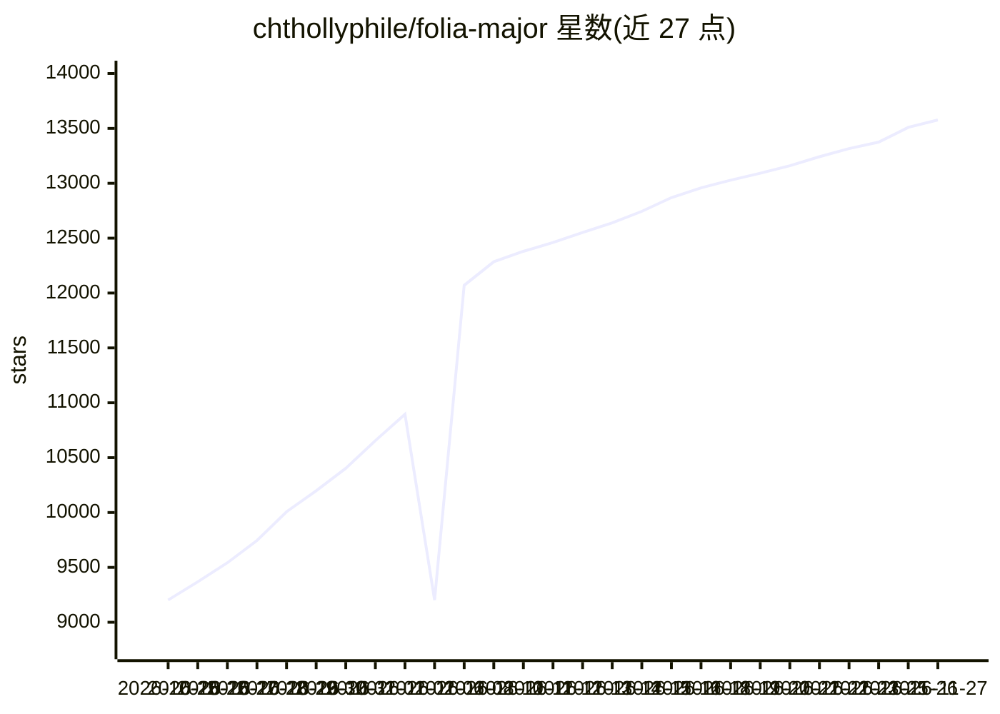

# chthollyphile/folia-major

⭐ 13,577 · TypeScript · AGPL-3.0 · 推送 2026-11-26 · [GitHub](https://github.com/chthollyphile/folia-major) · [官网](https://folia-site.cielaniska.top/) · 个人维护 · 中文 README

**面向音乐爱好者的沉浸式歌词动画播放器**

以全屏沉浸式歌词播放为核心的在线音乐播放器，支持网易云、酷狗、QQ 音乐、Navidrome 与本地音乐库，桌面端另支持波点音乐、YouTube Music、Spotify 等来源。提供多种歌词动画主题与可调排版参数，自动匹配在线歌词与封面，读取 .lrc/.vtt/.ttml/.qrc/.yrc/.krc 本地歌词文件，并基于歌曲情绪与歌词内容用 AI 生成背景配色主题。提供 Electron 桌面安装包、Vercel/Cloudflare/Docker 部署的 Web 版、PWA 及可选自托管同步服务端，桌面版内置 Folium 模组系统。

## 筛选速览

| 维度 | 判定 | 备注 |
|---|---|---|
| AI 角色 | `ai-enhanced` | 去掉 AI 部分产品仍成立 |
| 许可风险 | `viral` | AGPL-3.0 |
| 部署形态 | `desktop` | 安装包/桌面程序 |
| 模型依赖 | — | README 未给出锁定关系 |
| 硬件要求 | — | 无带数字的原话,不猜 |
| 安装摩擦 | `low` | 无编译、无系统依赖或容器化 |
| 成熟度 | — | 结构信号不足 |

## 能力要点

- 多种全屏歌词动画主题，支持响应式布局与可调参数
- 智能歌词匹配：按网易云、QQ、酷狗依次回退补全歌曲信息
- AI 基于歌曲情绪与歌词内容生成沉浸式背景主题
- Folium 模组系统：通过模组扩展歌词动画、音源等（仅桌面版）

## 适用场景

- 在线搜索并播放网易云、QQ、酷狗等平台歌曲并自动加载歌词
- 将本地音乐库接入播放器并自动匹配逐字歌词
- 部署到 Vercel 或自托管后在手机上以 PWA 使用
- 跨设备同步外观设置与 AI 主题库

## 场景标签

 · 领域:多媒体/音乐播放

## 证据(README 行号)

> L30: Folia是一个以全屏沉浸式歌词播放为核心的在线音乐播放器，支持网易云、酷狗、QQ 音乐、Navidrome 和本地音乐库，桌面端还支持波点音乐、YouTube Music、Spotify 和汽水音乐，通过智能歌词匹配，AI生成配
> L104: |AI 主题生成|基于歌曲情绪与歌词内容生成沉浸式背景与视觉参数。|

## 星数曲线

2026-10-25 9,203 → 2026-11-27 13,577（+4,374）

---
*卡片 v1 · prompt 1.4 · 生成 2026-11-26 · 置信度 high · 依据 README sha `d65ad1c294f1` · [字段定义](../../DATASET.md)*
