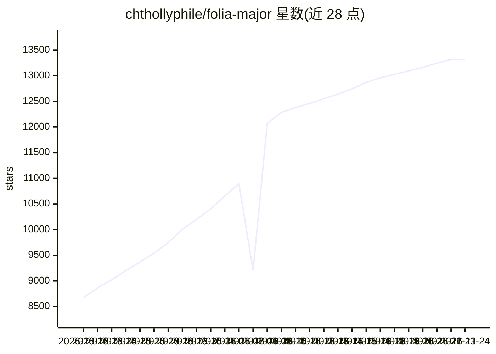

# chthollyphile/folia-major

⭐ 13,316 · TypeScript · AGPL-3.0 · 推送 2026-11-22 · [GitHub](https://github.com/chthollyphile/folia-major) · [官网](https://folia-site.cielaniska.top/) · 个人维护 · 中文 README

**以歌词动画为核心的本地/在线多平台音乐播放器**

以全屏沉浸式歌词播放为核心的音乐播放器，接入网易云、酷狗、QQ 音乐、Navidrome 与本地音乐库，桌面端另支持波点音乐、YouTube Music、Spotify 等源。关键机制包括按网易云、QQ、酷狗依次回退的自动歌词与封面匹配、基于歌曲情绪与歌词内容的 AI 配色主题生成、多种可调参数的全屏歌词动画，以及可安装歌词动画与背景扩展的桌面版模组系统。提供 Electron 桌面安装包、Node.js Web 版（可部署到 Vercel/Cloudflare/Docker）与 PWA 移动端使用方式，另提供可选的自托管同步服务端。

## 筛选速览

| 维度 | 判定 | 备注 |
|---|---|---|
| AI 角色 | `ai-enhanced` | 去掉 AI 部分产品仍成立 |
| 许可风险 | `viral` | AGPL-3.0 |
| 部署形态 | `self-host` | docker 或自建部署 |
| 模型依赖 | — | README 未给出锁定关系 |
| 硬件要求 | — | 无带数字的原话,不猜 |
| 安装摩擦 | `low` | 无编译、无系统依赖或容器化 |
| 成熟度 | `idea` | |

## 能力要点

- 接入网易云、酷狗、QQ 音乐、Navidrome 与本地音乐库的多源播放
- AI 基于歌曲情绪与歌词内容生成沉浸式配色主题
- 支持 .lrc/.vtt/.ttml/.qrc/.yrc/.krc 等多格式歌词文件与逐字歌词
- 桌面版 Folium 模组系统与官方认证模组市场

## 适用场景

- 在桌面或浏览器全屏欣赏歌词动画听歌
- 把本地音乐库的歌词和封面自动在线匹配补全
- 自托管 Web 版或同步服务端，在多设备同步主题设置

## 场景标签

 · 领域:多媒体/音乐播放

## 证据(README 行号)

> L30: Folia是一个以全屏沉浸式歌词播放为核心的在线音乐播放器，支持网易云、酷狗、QQ 音乐、Navidrome 和本地音乐库，桌面端还支持波点音乐、YouTube Music、Spotify 和汽水音乐，通过智能歌词匹配，AI生成配
> L104: |AI 主题生成|基于歌曲情绪与歌词内容生成沉浸式背景与视觉参数。|

## 星数曲线

2026-10-22 8,677 → 2026-11-24 13,316（+4,639）

---
*卡片 v1 · prompt 1.4 · 生成 2026-11-23 · 置信度 high · 依据 README sha `aafe7d3cd8a1` · [字段定义](../../DATASET.md)*
