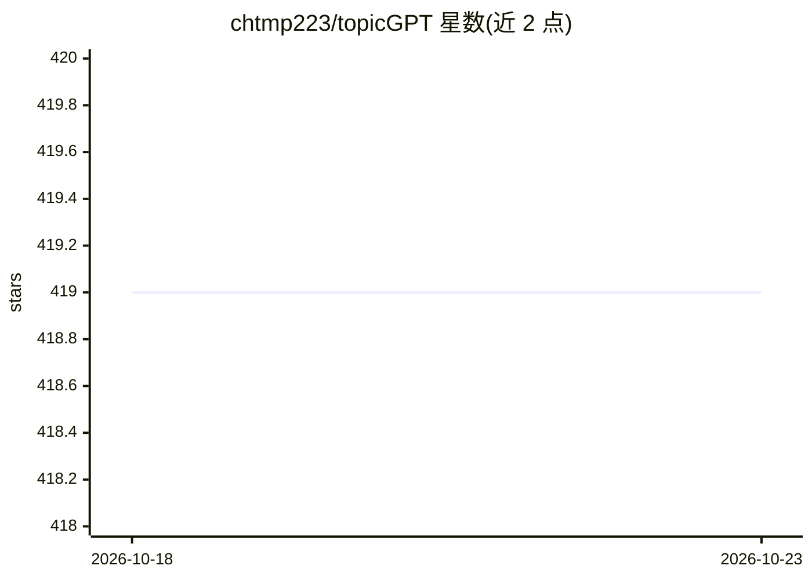

# chtmp223/topicGPT

⭐ 419 · Python · MIT · 推送 2026-06-15 · [GitHub](https://github.com/chtmp223/topicGPT) · [官网](https://chtmp223.github.io/topicGPT) · 组织维护

**基于 LLM 提示的主题建模框架，为文档生成并分配主题**

NAACL'24 论文 TopicGPT 的官方代码库，以 pip 包 topicgpt_python 提供五个核心函数：两级主题生成、主题精炼（合并相似主题、移除低频主题）、主题分配（附支持引文）与主题校正（重新提示使分配贴合主题列表）。支持 OpenAI API、VertexAI、Azure API、Gemini API 与 vLLM 后端。输入为 jsonl 文档文件，另提供 ARI/Harmonic Purity/NMI 指标计算以评估与真实标签的对齐度。README 建议先在子集上用便宜或开源模型调试。

## 筛选速览

| 维度 | 判定 | 备注 |
|---|---|---|
| AI 角色 | `ai-native` | 本体是模型或模型工具 |
| 许可风险 | `permissive` | MIT |
| 部署形态 | `library` | 以包/库形式分发 |
| 模型依赖 | local-ok | 支持本地模型 |
| 硬件要求 | — | 无带数字的原话,不猜 |
| 安装摩擦 | `low` | 无编译、无系统依赖或容器化 |
| 成熟度 | — | 结构信号不足 |

## 能力要点

- 两级主题生成与精炼（合并/移除）流程
- 主题分配附带支持引文，并有重提示校正步骤
- 支持 OpenAI/VertexAI/Azure/Gemini API 及 vLLM（需 GPU 推理）
- 提供 ARI、Harmonic Purity、NMI 指标计算函数

## 适用场景

- 对文档集合做 LLM 驱动的主题建模
- 评估生成主题与人工标签的对齐度
- 研究提示式主题建模与论文复现

## 场景标签

`数据分析` · 领域:效率与自动化

## 证据(README 行号)

> L4: This repository contains scripts and prompts for our paper "TopicGPT: Topic Modeling by Prompting Large Language Mod
> L14: - [11/09/24] Python package `topicgpt_python` is released! You can install it via `pip install topicgpt_python`. We

## 星数曲线

2026-10-18 419 → 2026-10-23 419（+0）

---
*卡片 v1 · prompt 1.4 · 生成 2026-10-22 · 置信度 high · 依据 README sha `7229f1b3115e` · [字段定义](../../DATASET.md)*
