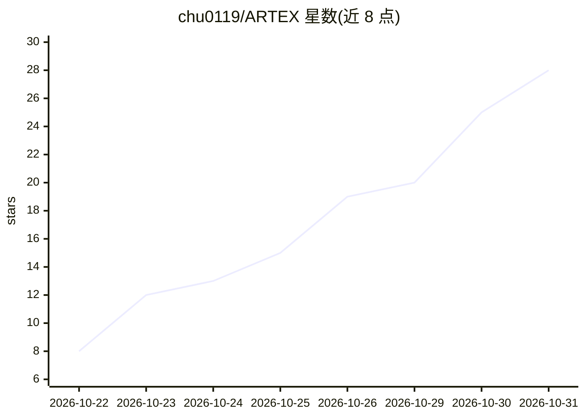

# chu0119/ARTEX

⭐ 28 · Go · AGPL-3.0 · 推送 2026-10-30 · [GitHub](https://github.com/chu0119/ARTEX) · [官网](https://github.com/chu0119/ARTEX/releases) · 个人维护 · 中文 README

**LLM 多 agent 驱动的自主渗透测试系统（Go+Next.js）**

由个人接手维护的独立版 ARTEX（原作者仓库已删除）：Go 单体后端内嵌 Next.js 前端 + PostgreSQL，agent 能力由 norma SDK 提供。核心为双图架构（全局资产图 + 每任务探索图，靠锚点相连），planner 持跨唤醒共享 todolist 派发意图，worker 领意图执行并写回，支持 worker 间过程级信息交换、人在环路审批、MITM 流量录制、漏洞复测 Agent 与 ScopeSentry 资产同步。需配置 ANTHROPIC 或 OPENAI API Key。提供一键部署脚本、Docker、预编译二进制与源码编译四种方式，含 Web 端一键更新与回滚。仅供本地隔离环境学习验证。

## 筛选速览

| 维度 | 判定 | 备注 |
|---|---|---|
| AI 角色 | `ai-native` | 本体是模型或模型工具 |
| 许可风险 | `viral` | AGPL-3.0 |
| 部署形态 | `self-host` | docker 或自建部署 |
| 模型依赖 | — | README 未给出锁定关系 |
| 硬件要求 | — | 无带数字的原话,不猜 |
| 安装摩擦 | `low` | 无编译、无系统依赖或容器化 |
| 成熟度 | — | 结构信号不足 |

## 能力要点

- 双图架构：全局资产图 + 每任务探索图，锚点关联支撑资产覆盖度
- planner 共享 todolist 按依赖逐步派意图，支撑多步攻击链稳定推进
- worker 间过程级信息交换（检索其他 work 执行过程）
- 一键部署脚本/页面一键更新/自动回滚，升级保留数据

## 适用场景

- 在本地隔离环境中验证自主渗透测试的技术原理
- 跨任务维护资产真值库并查看测试覆盖情况
- 对漏洞发起独立的 AI 复测会话并跟踪修复状态

## 场景标签

`多智能体` `网络安全` · 领域:Agent 开发

## 证据(README 行号)

> L7: AI 自主渗透测试系统（Go 后端 + Next.js 前端）
> L288: ARTEX 是一套 **LLM 多 agent 驱动的自主渗透系统**：Go 单体后端（内嵌 Next.js 前端）+ PostgreSQL，agent 能力由 `norma` SDK 提供（`agentcore` / `too

## 星数曲线

2026-10-22 8 → 2026-10-31 28（+20）

---
*卡片 v1 · prompt 1.4 · 生成 2026-10-29 · 置信度 high · 依据 README sha `ddeadc2ac816` · [字段定义](../../DATASET.md)*
