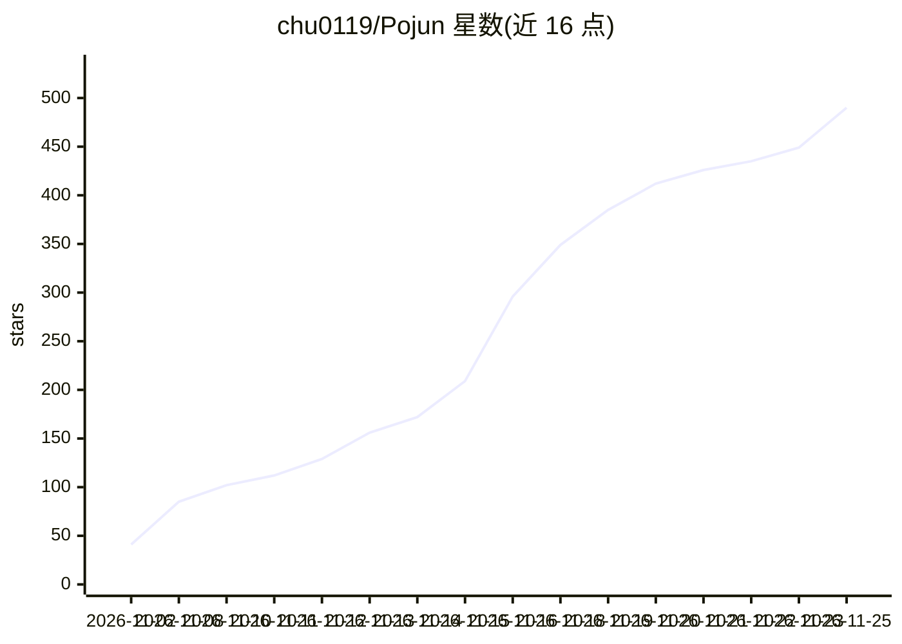

# chu0119/Pojun

⭐ 490 · Go · AGPL-3.0 · 推送 2026-11-23 · [GitHub](https://github.com/chu0119/Pojun) · [官网](https://github.com/chu0119/Pojun/releases) · 个人维护 · 中文 README

**给安全团队的一句话目标自主渗透测试平台**

以 Go 单体后端 + Next.js 前端 + PostgreSQL 构建的 LLM 多 Agent 渗透测试平台：输入一句话目标后自动执行目标拆解、侦察、漏洞挖掘、利用、后渗透与报告生成，人在环路可随时纠偏。关键机制包括带可核验验收标准的目标闸门、critical/high 漏洞的机械复现证据闸门、MITM 代理全程流量留痕、42 万 CVE/KEV/PoC 的按时间流情报运营，以及 deny/judge/ask 三层审批拦截。依赖 PostgreSQL，探索需在 UI 配置 LLM 通道；提供脚本安装、Docker Compose 与预编译包三种部署方式。

## 筛选速览

| 维度 | 判定 | 备注 |
|---|---|---|
| AI 角色 | `ai-native` | 本体是模型或模型工具 |
| 许可风险 | `viral` | AGPL-3.0 |
| 部署形态 | `self-host` | docker 或自建部署 |
| 模型依赖 | — | README 未给出锁定关系 |
| 硬件要求 | — | 无带数字的原话,不猜 |
| 安装摩擦 | `low` | 无编译、无系统依赖或容器化 |
| 成熟度 | — | 结构信号不足 |

## 能力要点

- 多 Agent 架构：planner 串行派发意图、worker 执行、mainagent 接管对话，支持人工审批与 steer_work 实时纠偏
- 全程证据链：HTTP/S 流量经 MITM 代理逐请求留存，finding 绑定四类流量证据并 sha256 版本化
- 漏洞情报按时间流运营：NVD 全量 42 万+ / CISA KEV / GitHub PoC 聚合，30 分钟快通道拉取 CVSS≥9.0
- 红队能力：反弹 shell 回连接收器、C2 出口 direct/SSH 中继/manual 三形态、22 个内置方法论技能

## 适用场景

- 对授权目标执行从侦察到报告的自动化渗透测试
- 红队作业中管理反弹 shell 回连与后渗透横向推进
- 将新爆出的高危 CVE 按时间流匹配自有资产并挂入任务
- 生成带复测命令与流量证据的 Word/Markdown 漏洞报告

## 场景标签

`多智能体` `网络安全` · 领域:Agent 开发

## 证据(README 行号)

> L72: Pojun 是一套 **LLM 多 Agent 自主渗透测试平台**：给一句话目标，它自动完成
> L23: > 依赖 **PostgreSQL**（安装脚本/Compose 自动处理）；探索需在 UI 里配置 **LLM**

## 星数曲线

2026-11-02 41 → 2026-11-25 490（+449）

---
*卡片 v1 · prompt 1.4 · 生成 2026-11-25 · 置信度 mid · 依据 README sha `bed2bf63f070` · [字段定义](../../DATASET.md)*
