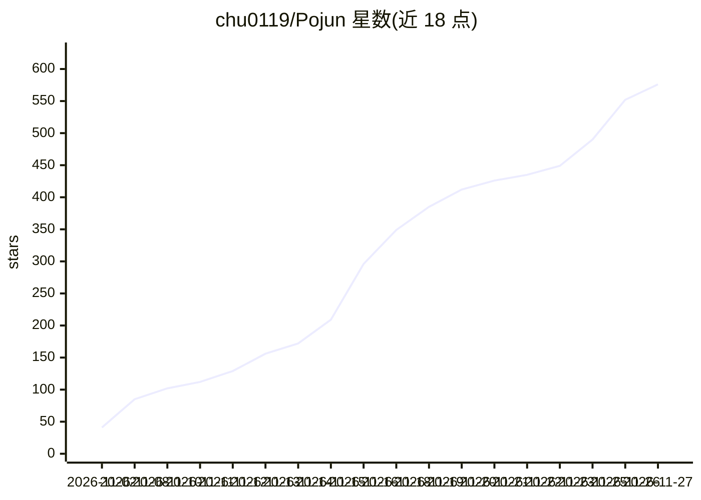

# chu0119/Pojun

⭐ 576 · Go · AGPL-3.0 · 推送 2026-11-26 · [GitHub](https://github.com/chu0119/Pojun) · [官网](https://github.com/chu0119/Pojun/releases) · 个人维护 · 中文 README

**给红队与授权测试者的 AI 自主渗透测试平台**

Go 单体后端 + Next.js 前端 + PostgreSQL 的渗透测试平台：从一句话目标出发，planner/worker/mainagent 多 Agent 自主推进，覆盖小程序/APK/源码/AI-LLM/云/AD/合约等攻击面。关键机制包括 goal_met 目标闸门、L1–L4 证据分级与四类流量绑定、finding 确定性回归、Program Profile 硬约束（allowlist/RPS/时间窗/并发）与任务级预算闸门，HTTP 默认经 MITM 留痕并交付 Word 报告。LLM 需在 UI 配置多通道（Anthropic/OpenAI/兼容网关轮询）。面向授权渗透、红队与 SRC 场景使用者。

## 筛选速览

| 维度 | 判定 | 备注 |
|---|---|---|
| AI 角色 | `ai-native` | 本体是模型或模型工具 |
| 许可风险 | `viral` | AGPL-3.0 |
| 部署形态 | `desktop` | 安装包/桌面程序 |
| 模型依赖 | — | README 未给出锁定关系 |
| 硬件要求 | — | 无带数字的原话,不猜 |
| 安装摩擦 | `low` | 无编译、无系统依赖或容器化 |
| 成熟度 | — | 结构信号不足 |

## 能力要点

- 多 Agent 自主推进：planner 派意图、worker CAS 领取执行、goal_met 闸门收官
- L1–L4 证据分级、baseline/proof/verification/supporting 四类流量绑定与确定性回归
- 24 Skill / 10 MCP / 92 工具 / 5 Playbook 全 UI 配置可组装
- SRC Program Profile 硬约束 + 每任务只读出口回执

## 适用场景

- 授权渗透测试项目从一句话目标到漏洞报告的自动化推进
- SRC/众测按 scope、速率与时间窗约束执行任务
- 微信小程序、APK、云/K8s、AD 等多攻击面安全评估
- 漏洞修复后的 proof 流量重放回归验证

## 场景标签

`多智能体` `网络安全` · 领域:Agent 开发

## 证据(README 行号)

> L5: **AI 自主渗透测试平台 · 从一句话目标到可交付漏洞报告**
> L17: **Go 单体后端** · **Next.js 内嵌前端** · **PostgreSQL** · **多 Agent 自主推进** · **全程证据留痕**
> L23: > 依赖 **PostgreSQL**（安装脚本/Compose 自动处理）；探索需在 UI 里配置 **LLM**

## 星数曲线

2026-11-02 41 → 2026-11-27 576（+535）

---
*卡片 v1 · prompt 1.4 · 生成 2026-11-27 · 置信度 mid · 依据 README sha `03837b50e6ad` · [字段定义](../../DATASET.md)*
