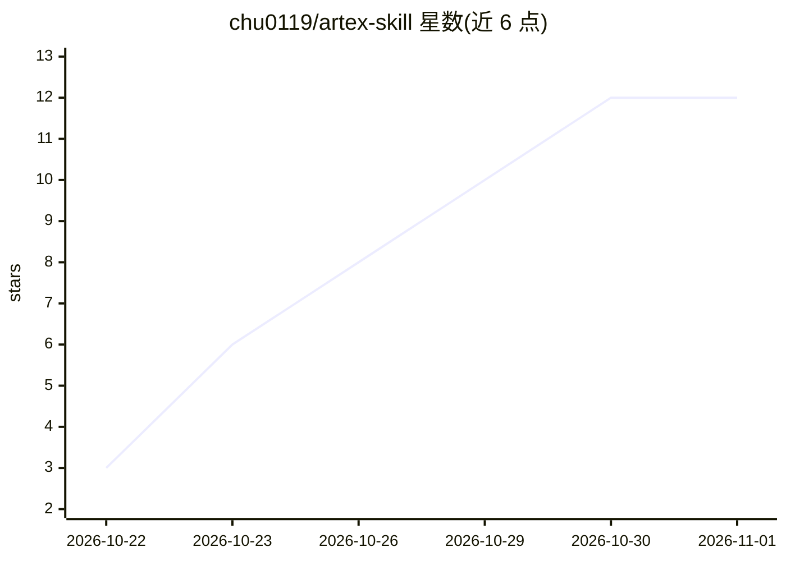

# chu0119/artex-skill

⭐ 12 · AGPL-3.0 · 推送 2026-10-09 · [GitHub](https://github.com/chu0119/artex-skill) · 个人维护 · 中文 README

**把 ARTEX 渗透测试方法论蒸馏为可移植 Agent Skill**

面向任意 AI Agent 的纯提示+markdown 文件技能包：将 ARTEX（百度攻防挑战赛冠军项目）方法论压缩为 planner/worker/auditor 三视角轮换协议、资产/事实/漏洞三账本证据纪律（observed/inferred 置信度、漏洞三重复现门槛）与四层安全护栏（scope 授权门、资产黑名单、危险命令拦截）。零依赖零基础设施，通过 git clone 到 skills 目录或粘贴 SKILL.md 使用；仅限授权测试场景，AGPL-3.0，与完整平台 ARTEX 同一维护者。

## 筛选速览

| 维度 | 判定 | 备注 |
|---|---|---|
| AI 角色 | `ai-ecosystem` | LLM/agent 周边工具 |
| 许可风险 | `viral` | AGPL-3.0 |
| 部署形态 | `None` |  |
| 模型依赖 | — | README 未给出锁定关系 |
| 硬件要求 | — | 无带数字的原话,不猜 |
| 安装摩擦 | `low` | 无编译、无系统依赖或容器化 |
| 成熟度 | — | 结构信号不足 |

## 能力要点

- 三视角协议：planner/worker/auditor 轮换，单 agent 模拟多智能体分工
- 资产/事实/漏洞三账本，每条事实带置信度与证据指针
- 四层安全护栏：授权门、操作约束、资产黑名单、危险命令拦截+人工确认
- 零基础设施零依赖，git clone 到 skills 目录即装即用

## 适用场景

- 给自己的 AI Agent 装载授权渗透测试工作流
- 在 SRC/众测/CTF 场景下用 agent 执行带证据纪律的渗透任务
- 让渗透过程产出结构化的资产/事实/漏洞账本与报告

## 场景标签

`提示工程` `网络安全` · 领域:Agent 开发

## 证据(README 行号)

> L7: 本技能把 ARTEX（AI 自主渗透测试系统，百度"agent+"攻防挑战赛冠军项目）的核心能力蒸馏成一个纯提示+文件驱动的 Agent Skill——零基础设施、零依赖，装上即用：
> L9: - **三视角协议**：planner（规划）/ worker（执行）/ auditor（对抗式自检）三视角轮换，单 agent 模拟多智能体分工

## 星数曲线

2026-10-22 3 → 2026-11-01 12（+9）

---
*卡片 v1 · prompt 1.4 · 生成 2026-11-01 · 置信度 high · 依据 README sha `d083c72cdbe7` · [字段定义](../../DATASET.md)*
