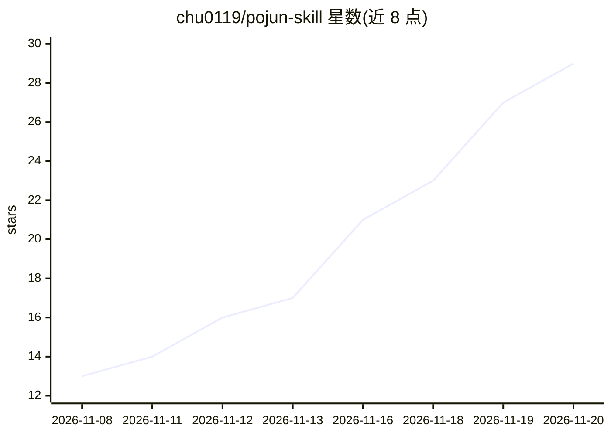

# chu0119/pojun-skill

⭐ 29 · AGPL-3.0 · 推送 2026-11-06 · [GitHub](https://github.com/chu0119/pojun-skill) · 个人维护 · 中文 README

**授权渗透测试方法论的可移植 Agent Skill（纯提示驱动）**

将 Pojun 渗透测试平台的核心方法论蒸馏为 SKILL.md + references 的纯提示+文件驱动技能，零依赖，可装入 Claude Code、ZCode、Cursor 等任意 AI Agent。内容包括 planner/worker/auditor 三视角轮换协议、资产/事实/漏洞三账本证据纪律、L1-L4 证据分级与机械验证闸门、四层安全护栏（授权门、资产黑名单、危险命令拦截）及 SRC 打法速查。仅限授权测试场景，AGPL-3.0 许可。

## 筛选速览

| 维度 | 判定 | 备注 |
|---|---|---|
| AI 角色 | `ai-knowledge` | 知识聚合/清单类 |
| 许可风险 | `viral` | AGPL-3.0 |
| 部署形态 | `None` |  |
| 模型依赖 | — | README 未给出锁定关系 |
| 硬件要求 | — | 无带数字的原话,不猜 |
| 安装摩擦 | `low` | 无编译、无系统依赖或容器化 |
| 成熟度 | — | 结构信号不足 |

## 能力要点

- 三视角协议：单 agent 模拟 planner/worker/auditor 分工
- L1-L4 证据分级与机械验证闸门，纯版本匹配不算漏洞
- 四层安全护栏：scope 授权门、.gov/.edu 资产黑名单、危险命令拦截
- 零基础设施、零依赖，git clone 或粘贴即用

## 适用场景

- 给 AI Agent 装上渗透测试方法论执行授权测试
- SRC/众测平台范围内按速查节奏与纪律挖洞
- 在 CTF 或自有系统上让 agent 以证据分级方式产出可复现漏洞记录

## 场景标签

`网络安全` · 领域:学习与行业

## 证据(README 行号)

> L7: 本技能把 Pojun（AI 自主渗透测试平台，前 ARTEX——百度"agent+"攻防挑战赛冠军项目的完全演进版）的核心能力蒸馏成一个纯提示+文件驱动的 Agent Skill——零基础设施、零依赖，装上即用：
> L9: - **三视角协议**：planner（规划）/ worker（执行）/ auditor（对抗式自检）三视角轮换，单 agent 模拟多智能体分工

## 星数曲线

2026-11-08 13 → 2026-11-20 29（+16）

---
*卡片 v1 · prompt 1.4 · 生成 2026-11-18 · 置信度 high · 依据 README sha `ae8e1d3450e1` · [字段定义](../../DATASET.md)*
