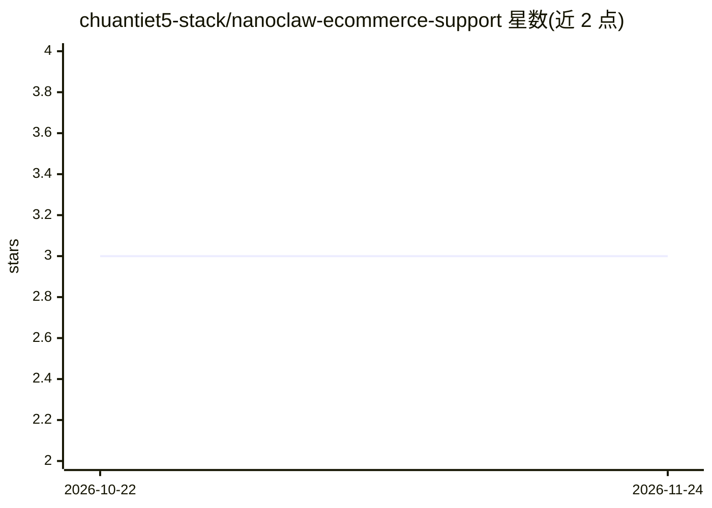

# chuantiet5-stack/nanoclaw-ecommerce-support

⭐ — · [GitHub]() · 个人维护 · 中文 README

**电商客服 Agent：商品订单查询、售后与人工接入**

Python 编写的电商客服 Agent 应用，覆盖商品搜索与下单、订单/物流/退款/售后工单处理、人工客服接入与工作台；配套独立模拟商家 API 与后台，本地生成演示数据。采用 OpenAI 兼容接口调用模型，api_key 留空时切换为无模型密钥的离线规则模式。支持 Web、命令行、飞书和 QQ 渠道；商家与客服两个服务可分别安装依赖、单独运行，测试用 pytest 组织。

## 筛选速览

| 维度 | 判定 | 备注 |
|---|---|---|
| AI 角色 | `ai-native` | 本体是模型或模型工具 |
| 许可风险 | `none` | — |
| 部署形态 | `library` | 以包/库形式分发 |
| 模型依赖 | — | README 未给出锁定关系 |
| 硬件要求 | — | 无带数字的原话,不猜 |
| 安装摩擦 | `low` | 无编译、无系统依赖或容器化 |
| 成熟度 | — | 结构信号不足 |

## 能力要点

- 模型驱动 Agent 与离线规则模式双路径，api_key 可选
- 模拟商家 API 与经营看板，首次启动自动创建演示数据
- 支持 Web、命令行、飞书、QQ 四种渠道
- 客服与商家服务可拆分独立安装运行

## 适用场景

- 给电商店铺搭一套商品与售后咨询的客服机器人
- 通过模拟商家 API 本地演示和测试客服流程
- 在无模型密钥环境下用规则模式体验客服功能
- 接入飞书或 QQ 做渠道客服

## 场景标签

`聊天机器人` · 领域:对话与助手

## 证据(README 行号)

> L3: 面向商品咨询、订单查询和售后处理的 Python Agent 应用，配套独立模拟商家 API 和商家后台。
> L11: - 模型驱动 Agent 与无模型密钥的离线规则模式。

## 星数曲线

2026-10-22 3 → 2026-11-24 3（+0）

---
*卡片 v1 · prompt 1.4 · 生成 2026-11-22 · 置信度 high · 依据 README sha `88d076f2332b` · [字段定义](../../DATASET.md)*
