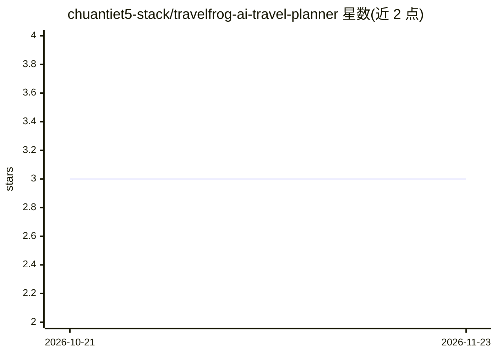

# chuantiet5-stack/travelfrog-ai-travel-planner

⭐ 3 · HTML · 推送 2026-10-12 · [GitHub](https://github.com/chuantiet5-stack/travelfrog-ai-travel-planner) · 个人维护 · 中文 README

**面向旅行者的多渠道对话式行程规划助手**

基于 Python/Flask 的旅行规划应用：Agent 通过多轮对话收集目的地、天数、预算与同行人数，匹配城市与景点并展示推荐理由，经 MCP 调用地图、天气与景点图片工具。配套景点网站提供登录注册、收藏评论与管理后台，支持 Web、命令行、飞书和 QQ 渠道接入。采用 OpenAI 兼容接口调用模型，需自行配置模型接口密钥与工具凭证，地图与 MCP 验证脚本依赖相应服务。

## 筛选速览

| 维度 | 判定 | 备注 |
|---|---|---|
| AI 角色 | `ai-native` | 本体是模型或模型工具 |
| 许可风险 | `none` | — |
| 部署形态 | `library` | 以包/库形式分发 |
| 模型依赖 | — | README 未给出锁定关系 |
| 硬件要求 | — | 无带数字的原话,不猜 |
| 安装摩擦 | `low` | 无编译、无系统依赖或容器化 |
| 成熟度 | — | 结构信号不足 |

## 能力要点

- 多轮对话收集行程偏好并维护会话状态
- 通过 MCP 调用地图、天气与景点图片工具
- 支持 Web、命令行、飞书和 QQ 四种渠道
- 配套景点网站含收藏、评论与管理后台

## 适用场景

- 让 AI 帮我按预算和天数推荐目的地和景点
- 在飞书或 QQ 里直接查询旅行建议
- 搭建带管理后台的景点收藏评论网站

## 场景标签

`聊天机器人` `AI 助手` · 领域:对话与助手

## 证据(README 行号)

> L1: # TravelFrog — 智能旅行规划助手
> L3: 基于 Python 的旅行规划应用，结合多轮对话、景点推荐、地图与天气工具，提供旅行建议和景点管理功能。
> L9: - 通过 MCP 调用地图、天气和景点图片工具。

## 星数曲线

2026-10-21 3 → 2026-11-23 3（+0）

---
*卡片 v1 · prompt 1.4 · 生成 2026-11-22 · 置信度 high · 依据 README sha `322f36d06e7e` · [字段定义](../../DATASET.md)*
