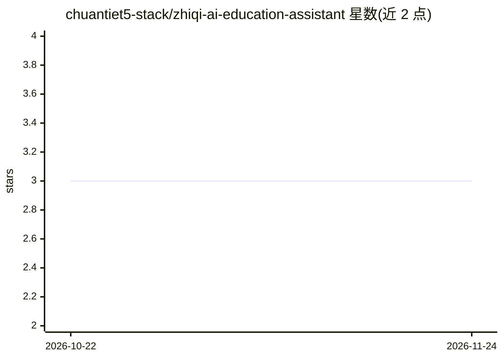

# chuantiet5-stack/zhiqi-ai-education-assistant

⭐ 3 · Python · 推送 2026-10-12 · [GitHub](https://github.com/chuantiet5-stack/zhiqi-ai-education-assistant) · 个人维护 · 中文 README

**面向学生与家长的教育 Agent 应用：RAG 问答、批改与陪学**

以 FastAPI 构建的学习辅助应用，提供学习对话、多模态作业批改、学习计划与自习陪学功能。教材经解析与 Embedding 后入 FAISS 检索；通过 OpenAI 兼容接口接入文本与视觉模型；另含 YOLO Pose 坐姿/专注分析、B 站视频搜索、古诗词 MCP 工具、家长绑定与学习报告。从源码安装，需自建账号、导入教材并填写模型接口密钥；专注监控依赖摄像头，无自动化测试套件。

## 筛选速览

| 维度 | 判定 | 备注 |
|---|---|---|
| AI 角色 | `ai-native` | 本体是模型或模型工具 |
| 许可风险 | `none` | — |
| 部署形态 | `library` | 以包/库形式分发 |
| 模型依赖 | — | README 未给出锁定关系 |
| 硬件要求 | — | 无带数字的原话,不猜 |
| 安装摩擦 | `low` | 无编译、无系统依赖或容器化 |
| 成熟度 | — | 结构信号不足 |

## 能力要点

- 教材 RAG：Embedding + FAISS 检索与知识库管理页
- 多模态作业批改与学习计划生成
- 基于 YOLO Pose 的坐姿与专注状态分析
- Web 工作台与飞书渠道接入

## 适用场景

- 导入自己的教材做问答与作业批改
- 自习时用摄像头监测坐姿与专注状态
- 家长绑定查看学习报告

## 场景标签

`RAG` `目标检测` `文档问答` · 领域:知识与检索

## 证据(README 行号)

> L3: 结合教育 Agent、教材检索和本地视觉分析的学习辅助应用，提供学习对话、作业批改、学习计划和自习陪学功能。
> L8: - 教材解析、Embedding 和 FAISS 检索。

## 星数曲线

2026-10-22 3 → 2026-11-24 3（+0）

---
*卡片 v1 · prompt 1.4 · 生成 2026-11-22 · 置信度 high · 依据 README sha `6d52deed0986` · [字段定义](../../DATASET.md)*
