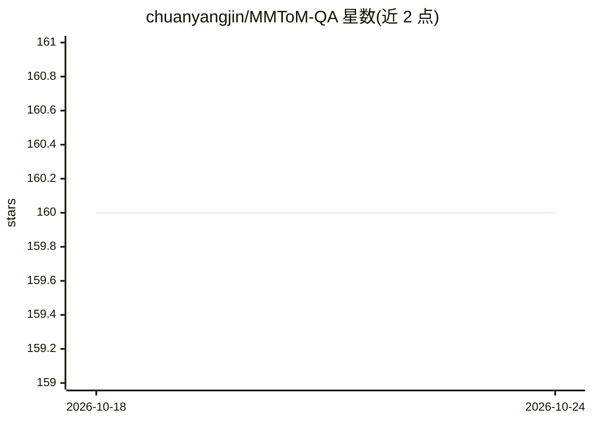

# chuanyangjin/MMToM-QA

⭐ 160 · Python · Apache-2.0 · 推送 2026-06-28 · [GitHub](https://github.com/chuanyangjin/MMToM-QA) · [官网](https://arxiv.org/abs/2401.08743) · 组织维护

**多模态心智理论问答基准与 BIP-ALM 方法实现（ACL 2024）**

ACL 2024 杰出论文 MMToM-QA 的官方代码库，包含两部分：BIP-ALM 方法实现（从视频提取符号表示、文本解析融合、用微调 LLaMA 2 做逆向推理预测 agent 的目标与信念）与 MMToM-QA 基准使用指南。基准含 600 道题，提供纯文本、多模态、纯视频三种版本，视频数据 257 GB，另提供 1,000 个带标注的合成训练视频，训练集不含示例问答以避免过拟合。面向机器 ToM 研究者。

## 筛选速览

| 维度 | 判定 | 备注 |
|---|---|---|
| AI 角色 | `ai-knowledge` | 知识聚合/清单类 |
| 许可风险 | `permissive` | Apache-2.0 |
| 部署形态 | `None` |  |
| 模型依赖 | — | README 未给出锁定关系 |
| 硬件要求 | — | 无带数字的原话,不猜 |
| 安装摩擦 | `low` | 无编译、无系统依赖或容器化 |
| 成熟度 | — | 结构信号不足 |

## 能力要点

- BIP-ALM：贝叶斯逆向规划结合语言模型，从视频/文本提取符号表示后推理 agent 目标与信念
- MMToM-QA：首个评估机器心智理论的多模态基准，600 题，三种评测版本
- 提供 GPT-4/GPT-4V 测试脚本示例
- 训练集为 1,000 个程序合成视频，带场景/物体/目标/信念真值标注且不含示例 QA

## 适用场景

- 评测模型理解人类目标与信念的心智理论能力
- 在标准基准上对比自己的模型与 GPT-4/GPT-4V
- 复现或扩展 BIP-ALM 方法

## 场景标签

`模型评测` `多模态` · 领域:评测与运维

## 证据(README 行号)

> L50: ## 🐳 MMToM-QA Benchmark
> L52: MMToM-QA is the first multimodal benchmark to evaluate machine Theory of Mind (ToM), the ability to understand peop
> L6: This repo features the code for the paper **MMToM-QA: Multimodal Theory of Mind Question Answering**.

## 星数曲线

2026-10-18 160 → 2026-10-24 160（+0）

---
*卡片 v1 · prompt 1.4 · 生成 2026-10-22 · 置信度 high · 依据 README sha `6329ed81b0dd` · [字段定义](../../DATASET.md)*
