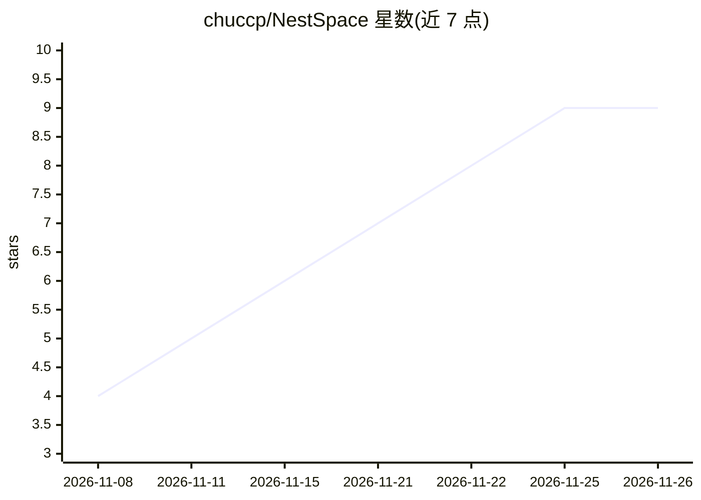

# chuccp/NestSpace

⭐ 9 · Kotlin · Apache-2.0 · 推送 2026-11-25 · [GitHub](https://github.com/chuccp/NestSpace) · [官网](https://chuccp.github.io/NestSpace/) · 个人维护 · 中文 README

**Android 应用级虚拟空间：多开隔离+AI 助手+MCP 控制**

在 Android 上以普通应用形式运行的应用级虚拟空间：可把第三方 APK 安装进空间、创建多个数据隔离的实例并在自带桌面启动整理。AI 助手通过应用内部通道观察和操作虚拟应用，无需无障碍服务与 adb；支持 Claude/OpenAI 兼容接口配置模型、自动记忆与技能起草、离线语音悬浮球。内置 MCP 服务，Claude Code 等客户端可远程控制容器与插件。实验性项目，声明不保证所装 App 兼容性，容器进程上限 16 个；可选 Root 宿主控制操作真实设备应用。

## 筛选速览

| 维度 | 判定 | 备注 |
|---|---|---|
| AI 角色 | `ai-enhanced` | 去掉 AI 部分产品仍成立 |
| 许可风险 | `permissive` | Apache-2.0 |
| 部署形态 | `None` |  |
| 模型依赖 | locked-api |  |
| 硬件要求 | — | 无带数字的原话,不猜 |
| 安装摩擦 | `high` | 编译与系统依赖俱全 |
| 成熟度 | `idea` | |

## 能力要点

- 多实例多开，实例间文件、缓存、数据库与登录状态相互隔离
- AI 助手经应用内部通道控制虚拟应用，不需无障碍权限、adb 或 root
- Java-first 插件 SDK：Agent 工具/Hook、LLM Provider、运行时代理与 .nest 插件安装
- 内置 MCP 服务，Claude Code 等客户端经 USB 或局域网远程调用容器工具

## 适用场景

- 同一应用在一部手机上同时登录多个账号
- 用自然语言让 AI 助手代为操作虚拟空间里的应用
- 从电脑上通过 Claude Code 远程控制手机中的容器
- 不修改系统、不 root 的前提下安装和隔离第三方 APK

## 场景标签

`AI 助手` · 领域:对话与助手

## 证据(README 行号)

> L8: **在 Android 上运行应用级虚拟空间的实验性开源项目。**
> L10: NestSpace 可以把第三方 APK 安装到应用内部，创建多个相互隔离的实例，并在自带桌面上启动、整理它们。运行时、桌面和 AI 助手统一位于主应用内；`plugin-api` 对外提供 Java 插件 SDK，`MCP` 控
> L125: - **虚拟空间**：导入单 APK 或 base + split，应用级安装和启动。

## 星数曲线

2026-11-08 4 → 2026-11-26 9（+5）

---
*卡片 v1 · prompt 1.4 · 生成 2026-11-20 · 置信度 high · 依据 README sha `460a8e3a9cb0` · [字段定义](../../DATASET.md)*
