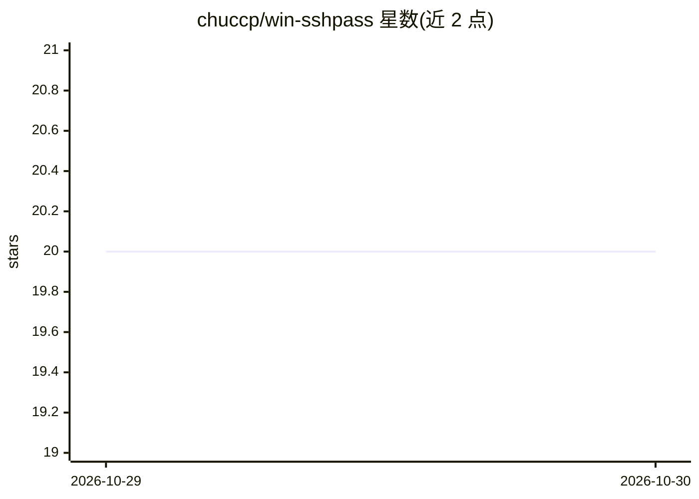

# chuccp/win-sshpass

⭐ 20 · Go · Apache-2.0 · 推送 2026-10-28 · [GitHub](https://github.com/chuccp/win-sshpass) · [官网](https://chuccp.github.io/win-sshpass/) · 个人维护 · 中文 README

**面向 AI 自动化的跨平台 SSH 客户端，含 MCP 工具与 Web 控制台**

Go 编写的跨平台 SSH 客户端（Windows/Linux/macOS），支持密码、私钥、ssh-agent 等非交互认证，提供远程命令执行与 JSON 输出、SFTP/SCP/Rsync 传输、端口转发与 SOCKS/HTTP 代理。Web 服务器以 Streamable HTTP 暴露 MCP 端点，供 AI agent 调用 ssh_exec、sftp_list、sftp_read 等 6 个工具；浏览器端提供 xterm.js 终端与 SFTP 文件管理器。另提供可复用 Go SDK。安装途径包括 winget、scoop、GitHub Releases 安装包与源码构建，无需外部运行时。

## 筛选速览

| 维度 | 判定 | 备注 |
|---|---|---|
| AI 角色 | `ai-ecosystem` | LLM/agent 周边工具 |
| 许可风险 | `permissive` | Apache-2.0 |
| 部署形态 | `desktop` | 安装包/桌面程序 |
| 模型依赖 | — | README 未给出锁定关系 |
| 硬件要求 | — | 无带数字的原话,不猜 |
| 安装摩擦 | `low` | 无编译、无系统依赖或容器化 |
| 成熟度 | — | 结构信号不足 |

## 能力要点

- 非交互 SSH：密码/私钥/ssh-agent 认证，JSON 输出、重试、超时、代理
- MCP 端点暴露 ssh_exec 与 5 个 SFTP 工具，供 AI agent 调用
- Web SSH 工作台：xterm.js 终端 + SFTP 文件管理与拖拽上传
- SFTP/SCP/Rsync 传输、本地/远程端口转发、SOCKS4/5/HTTP(S) 代理

## 适用场景

- 让 AI agent 通过 MCP 在远程服务器执行命令和读写文件
- 脚本中非交互式 SSH 认证与自动化运维
- 浏览器中管理远程终端会话与文件传输

## 场景标签

 · 领域:开发者工具/远程访问

## 证据(README 行号)

> L10: `win-sshpass` is a cross-platform SSH client designed for AI-driven automation
> L24: - MCP tools for SSH execution and SFTP file operations.
> L84: The Web server exposes MCP Streamable HTTP at:

## 星数曲线

2026-10-29 20 → 2026-10-30 20（+0）

---
*卡片 v1 · prompt 1.4 · 生成 2026-10-28 · 置信度 high · 依据 README sha `59b8303161f1` · [字段定义](../../DATASET.md)*
