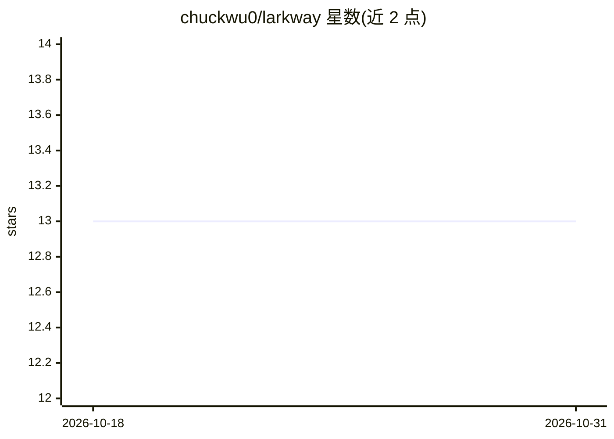

# chuckwu0/larkway

⭐ 13 · TypeScript · MIT · 推送 2026-10-29 · [GitHub](https://github.com/chuckwu0/larkway) · [官网](https://larkway.dev) · 个人维护 · 中文 README

**把 Claude Code/Codex 订阅变成飞书团队可 @ 的编码 agent 桥**

Larkway 是运行在用户本机/常驻主机上的桥接服务：订阅飞书长连接事件，将群内 @ 消息转发给本地的 Claude Code、Codex 或 pi 子进程，解析 stream-json 输出并以节流实时更新的飞书卡片回传；维护 thread_id 到 session_id 的会话持久化。自身不做编排、API 调用或 worktree 管理，均交由 agent 完成。支持多 bot、Web UI、OS 服务守护、话题转飞书任务的生命周期同步。需 Node.js 20+、lark-cli 与 Claude/Codex 订阅，agent 子进程默认未沙箱、以宿主用户权限运行。

## 筛选速览

| 维度 | 判定 | 备注 |
|---|---|---|
| AI 角色 | `ai-ecosystem` | LLM/agent 周边工具 |
| 许可风险 | `permissive` | MIT |
| 部署形态 | `library` | 以包/库形式分发 |
| 模型依赖 | — | README 未给出锁定关系 |
| 硬件要求 | — | 无带数字的原话,不猜 |
| 安装摩擦 | `low` | 无编译、无系统依赖或容器化 |
| 成熟度 | `idea` | |

## 能力要点

- 飞书消息→本地 Claude Code/Codex/pi 子进程的桥接与会话持久化
- 三种后端：Claude Code（订阅登录）、Codex（订阅登录）、pi（自备 API key）
- 多 bot 同桥、Web UI 管理面板、launchd/systemd 服务守护
- 话题转飞书任务，agent 自动认领并同步任务生命周期

## 适用场景

- 团队在飞书群里 @ bot 查询代码实现细节
- 让 PM/QA/数据分析师自助获得基于真实仓库的答案
- 把 Claude Code 或 Codex 订阅共享给全团队使用

## 场景标签

`编码 Agent` · 领域:编码与开发

## 证据(README 行号)

> L36: - Feishu long-connection subscriber (inbound events)
> L44: - No GitHub/GitLab API calls (the agent runs `gh`/`glab` itself)
> L70: |**Claude Code**|`claude`|Local subscription login (`~/.claude/.credentials.json`)|Your existing Claude subscriptio

## 星数曲线

2026-10-18 13 → 2026-10-31 13（+0）

---
*卡片 v1 · prompt 1.4 · 生成 2026-10-31 · 置信度 high · 依据 README sha `1b0cae5545ed` · [字段定义](../../DATASET.md)*
