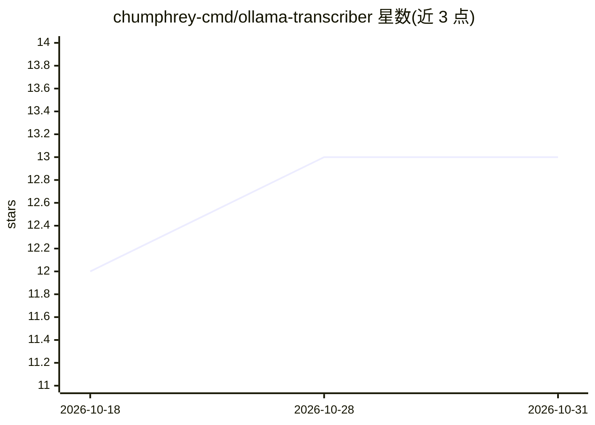

# chumphrey-cmd/ollama-transcriber

⭐ 13 · Python · 推送 2026-08-30 · [GitHub](https://github.com/chumphrey-cmd/ollama-transcriber) · 个人维护

**本地音频转写与会议摘要工具，全程离线不上传**

在用户本机处理 MP3/WAV 音频的转写与摘要工具：用 OpenAI Whisper 生成文本转写，通过本地运行的 Ollama LLM 产出结构化摘要（执行概览、内容分解、行动项、会议元数据）。支持 GUI 选文件或 CLI 指定文件、语言（90+ ISO 代码）与模型，结果分目录存入 results。可在 config.yaml 中切换 Ollama 模型与自定义摘要提示词。支持 Linux 与 Windows 11，需预装 Ollama 并拉取模型，GPU 为可选加速项。

## 筛选速览

| 维度 | 判定 | 备注 |
|---|---|---|
| AI 角色 | `ai-native` | 本体是模型或模型工具 |
| 许可风险 | `none` | — |
| 部署形态 | `desktop` | 安装包/桌面程序 |
| 模型依赖 | local-ok | 支持本地模型 |
| 硬件要求 | — | 无带数字的原话,不猜 |
| 安装摩擦 | `medium` | 含编译或系统依赖之一 |
| 成熟度 | — | 结构信号不足 |

## 能力要点

- Whisper 转写 + Ollama 本地 LLM 摘要，全程本地处理
- 自动生成含行动项与会议元数据的结构化摘要
- CLI 与 GUI 两种使用方式，支持 90+ 语言代码与自动检测
- config.yaml 可自定义 LLM 模型、采样参数与摘要提示词

## 适用场景

- 对会议录音或采访音频生成转写文本和行动项摘要
- 在敏感内容不允许上传的前提下本地处理音频
- 用不同大小的 Whisper 模型和本地 LLM 批量处理录音文件

## 场景标签

`语音识别` `AI 写作` · 领域:内容生成

## 证据(README 行号)

> L3: This project offers a privacy-focused solution for transcribing and summarizing audio recordings through entirely lo
> L5: The tool automatically generates structured summaries including:
> L127: * Install Ollama on your system and download your preferred model.

## 星数曲线

2026-10-18 12 → 2026-10-31 13（+1）

---
*卡片 v1 · prompt 1.4 · 生成 2026-10-31 · 置信度 mid · 依据 README sha `2fb01af979a6` · [字段定义](../../DATASET.md)*
