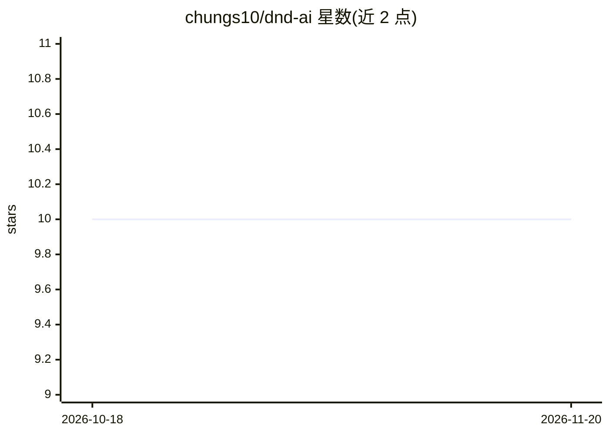

# chungs10/dnd-ai

⭐ 10 · Python · MIT · 推送 2025-12-23 · [GitHub](https://github.com/chungs10/dnd-ai) · 个人维护

**为 D&D 玩家提供带持久记忆的本地 AI 游戏主持人**

面向桌面角色扮演游戏的 AI Game Master 助手：以 mem0ai 定制本地实现管理跨会话的角色记忆，ChromaDB 存储语义记忆，Neo4j 记录实体关系与世界状态，Ollama 运行 Qwen3:8B 生成叙事。游戏机制（骰子、战斗、角色状态）由确定性 Python 函数调用执行，全部数据本地存储、无外部 API 依赖。为学校研究项目，由两名学生合作开发，状态为实验性质。

## 筛选速览

| 维度 | 判定 | 备注 |
|---|---|---|
| AI 角色 | `ai-native` | 本体是模型或模型工具 |
| 许可风险 | `permissive` | MIT |
| 部署形态 | `self-host` | docker 或自建部署 |
| 模型依赖 | local-ok | 支持本地模型 |
| 硬件要求 | — | 无带数字的原话,不猜 |
| 安装摩擦 | `low` | 无编译、无系统依赖或容器化 |
| 成熟度 | `idea` | |

## 能力要点

- mem0ai 定制本地实现提供跨会话持久角色记忆
- ChromaDB 语义记忆 + Neo4j 实体关系图的双存储
- 函数调用执行骰子、战斗等 D&D 规则判定
- Ollama + Qwen3:8B 本地部署，无外部 API 依赖

## 适用场景

- 跑团时让 AI 担任保持人设记忆的游戏主持人
- 研究 LLM 智能体的长期记忆方案
- 离线本地环境下运行 AI 叙事生成

## 场景标签

`AI 助手` `Agent 记忆` · 领域:Agent 开发

## 证据(README 行号)

> L3: An AI-powered Dungeons & Dragons assistant that integrates memory systems with game mechanics to create persistent A
> L31: - **AI Engine:** Ollama with Qwen3:8B model for narrative generation, enhanced with custom prompt templates for D&D

## 星数曲线

2026-10-18 10 → 2026-11-20 10（+0）

---
*卡片 v1 · prompt 1.4 · 生成 2026-11-19 · 置信度 mid · 依据 README sha `62ce7a3dfcae` · [字段定义](../../DATASET.md)*
