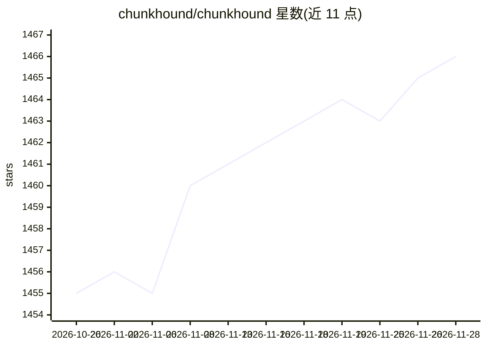

# chunkhound/chunkhound

⭐ 1,466 · Python · MIT · 推送 2026-11-27 · [GitHub](https://github.com/chunkhound/chunkhound) · [官网](https://chunkhound.ai) · 个人维护

**给开发者的本地代码/Git 历史索引引擎，向 AI agent 输出带引用的研究结果**

本地优先的代码研究引擎：通过 Tree-sitter 建立持久结构索引，结合正则精确检索与语义检索，覆盖当前代码、git 历史（commit/tag/branch/range）、网页与 PDF 等来源，返回带源引用的综合结果。通过 CLI 或 MCP（stdio/HTTP）将同一引擎暴露给上层 AI agent。正则检索无需任何 API key；语义检索需 embedding 提供方；深度研究需 LLM 与支持 rerank 的 embedding 提供方。数据库本地存储，MIT 许可，无平台许可或席位费。

## 筛选速览

| 维度 | 判定 | 备注 |
|---|---|---|
| AI 角色 | `ai-ecosystem` | LLM/agent 周边工具 |
| 许可风险 | `permissive` | MIT |
| 部署形态 | `library` | 以包/库形式分发 |
| 模型依赖 | local-ok | 支持本地模型 |
| 硬件要求 | — | 无带数字的原话,不猜 |
| 安装摩擦 | `low` | 无编译、无系统依赖或容器化 |
| 成熟度 | — | 结构信号不足 |

## 能力要点

- Tree-sitter 多语言结构索引：Python/JS/TS/Java/Go/Rust/C/C++ 等
- git 历史检索：按 last-N commits、commit hash、tag、branch、range
- 通过 MCP（stdio/HTTP）或 CLI 向 agent 输出带引用的研究结果
- 正则检索无需 API key，可选本地 embedding/LLM 实现零代码外发

## 适用场景

- 在大型仓库/monorepo 中让 agent 基于同一代码索引回答架构问题
- 理解大型 PR 或 release 的行为变更并起草 changelog
- 安全敏感环境中做本地化（零代码外发）的语义代码搜索
- 结合外部网页文档与本地代码溯源排查 bug

## 场景标签

`语义搜索` · 领域:知识与检索

## 证据(README 行号)

> L21:  Connect code, git history, rendered web pages, and technical documents through one local-first engine that returns
> L69: Use ChunkHound directly from the CLI or expose the same local research engine to higher-level AI agents through MCP

## 星数曲线

2026-10-26 1,455 → 2026-11-28 1,466（+11）

---
*卡片 v1 · prompt 1.4 · 生成 2026-11-26 · 置信度 high · 依据 README sha `06bbf0c9846d` · [字段定义](../../DATASET.md)*
