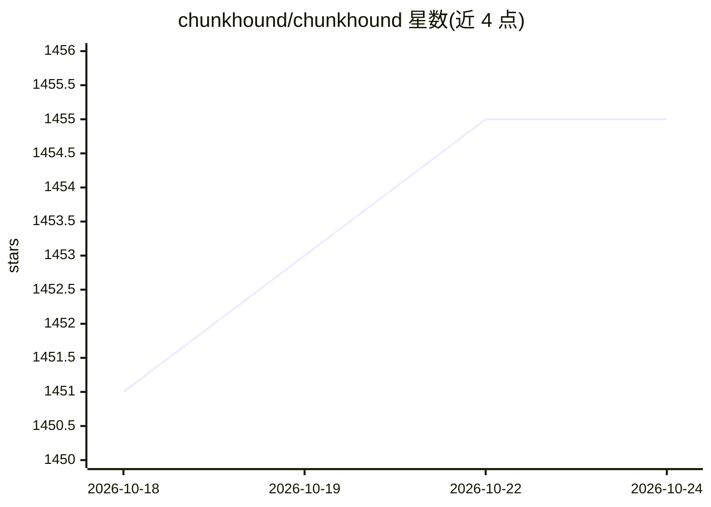

# chunkhound/chunkhound

⭐ 1,455 · Python · MIT · 推送 2026-10-22 · [GitHub](https://github.com/chunkhound/chunkhound) · [官网](https://chunkhound.ai) · 组织维护

**本地优先的代码库智能检索工具，给 agent 与团队提供带引用的上下文**

ChunkHound 对本地代码库、git 历史与技术网页资料建索引，通过 CLI 提供语义代码搜索、带引用的代码研究（research）、git 历史检索（按 commit/tag/range）与 web 研究，并可生成可分享文档。面向在大型仓库、多语言代码库或安全敏感环境中工作的开发者与工程团队。基于 Tree-sitter 支持多种语言，嵌入与 LLM 提供商可配置；正则搜索无需 API key，语义搜索与深度研究需相应提供商，可选择本地提供商实现零代码外流。

## 筛选速览

| 维度 | 判定 | 备注 |
|---|---|---|
| AI 角色 | `ai-ecosystem` | LLM/agent 周边工具 |
| 许可风险 | `permissive` | MIT |
| 部署形态 | `library` | 以包/库形式分发 |
| 模型依赖 | local-ok | 支持本地模型 |
| 硬件要求 | — | 无带数字的原话,不猜 |
| 安装摩擦 | `low` | 无编译、无系统依赖或容器化 |
| 成熟度 | — | 结构信号不足 |

## 能力要点

- 语义代码搜索与带引用的代码研究
- git 历史检索（last N / commit / tag / range）
- 本地优先索引，支持本地提供商零外流
- Tree-sitter 支持 Python/JS/TS/Java/Go/Rust/C++ 等语言

## 适用场景

- 在编码 agent 修改前提供架构与变更上下文
- 把大 PR 或发布区间的 diff 转成带引用的评审简报与变更日志
- 从堆栈与症状出发定位缺陷相关代码路径

## 场景标签

`语义搜索` · 领域:知识与检索

## 证据(README 行号)

> L21:  Open-source codebase intelligence that gives agents and teams cited context across current code, git history, and 
> L59: Give coding agents grounded architecture context, relevant files, recent changes, and external constraints before t
> L136: Index once, ask a real architecture question, and get a grounded answer with citations. Regex search works without

## 星数曲线

2026-10-18 1,451 → 2026-10-24 1,455（+4）

---
*卡片 v1 · prompt 1.4 · 生成 2026-10-21 · 置信度 high · 依据 README sha `e45c4205898d` · [字段定义](../../DATASET.md)*
