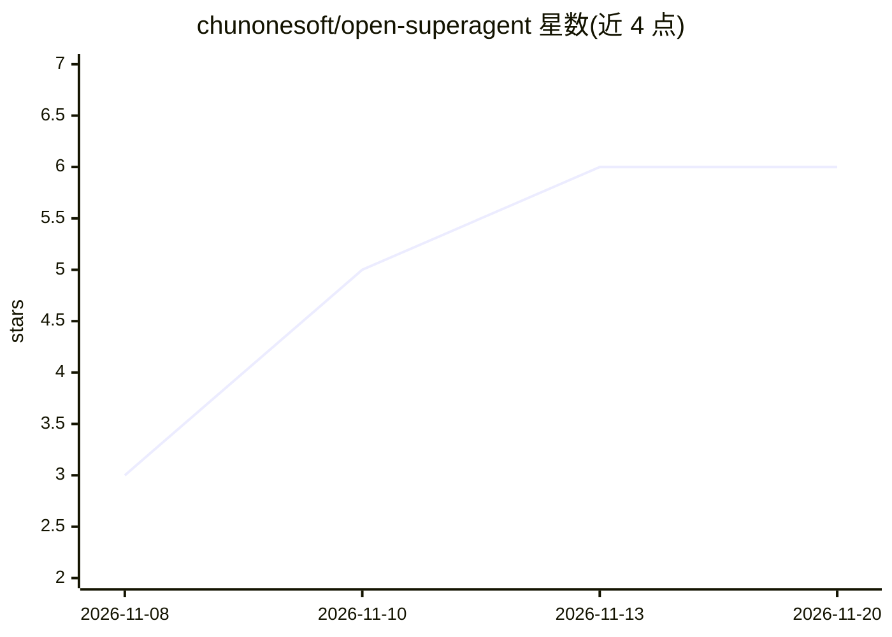

# chunonesoft/open-superagent

⭐ 6 · TypeScript · MIT · 推送 2026-11-11 · [GitHub](https://github.com/chunonesoft/open-superagent) · [官网](https://github.com/chunonesoft/open-superagent#readme) · 组织维护 · 中文 README

**给用自建 GitLab 和钉钉的团队接入的编程智能体**

基于 DeepSeek 开源 dsh-superagent-prototype 的社区维护分支（MIT），部署在 DeepSeek Harness 上运行。它在 Issue、PR 评论、群聊 @ 中接收需求，按授权策略决定是否接活，为每件事生成工单并在独立会话与目录中执行，交付 PR/MR 或结论；附 Web 面板列出待人工处理事项。相较官方原型补充自建 GitLab 与钉钉接入，定位为研究原型而非生产级软件，README 给出权限隔离与安全须知。

## 筛选速览

| 维度 | 判定 | 备注 |
|---|---|---|
| AI 角色 | `ai-native` | 本体是模型或模型工具 |
| 许可风险 | `permissive` | MIT |
| 部署形态 | `library` | 以包/库形式分发 |
| 模型依赖 | locked-api |  |
| 硬件要求 | — | 无带数字的原话,不猜 |
| 安装摩擦 | `low` | 无编译、无系统依赖或容器化 |
| 成熟度 | `idea` | |

## 能力要点

- 支持自建 GitLab（Todo/MR/评论/流水线）与钉钉（Stream 模式、按部门白名单同步）
- 工单制执行：每个任务在独立会话与目录中运行，结果回到原对话
- 统一 Source 接口，可扩展接入新的代码平台与聊天平台
- 按对话语言回复（中文群里回中文）

## 适用场景

- 内网 GitLab 团队在钉钉群里派活，自动修 bug 并提 MR
- 在 MR 评论中追加要求，让智能体在同一工单里继续修改
- 只接聊天不接代码平台，做报错溯源类的调研任务

## 场景标签

`编码 Agent` · 领域:编码与开发

## 证据(README 行号)

> L5: **能接自建 GitLab 和钉钉的主动式编程智能体：在群里 @ 它派活，它自己开工单、写代码、提 MR，再回到原对话里交付。**
> L23: dsh-superagent 是 DeepSeek 团队开源的一套「主动式编程智能体」，跑在 DeepSeek Harness 上。它不是一个等你开对话的聊天框，而是团队里的一个成员：
> L27: - **每件事开一个工单**，在独立的会话和目录里干活，互不干扰。

## 星数曲线

2026-11-08 3 → 2026-11-20 6（+3）

---
*卡片 v1 · prompt 1.4 · 生成 2026-11-20 · 置信度 high · 依据 README sha `b2d2aa59cbd5` · [字段定义](../../DATASET.md)*
