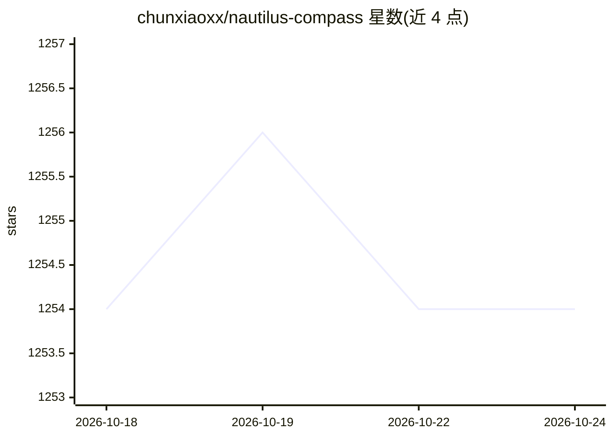

# chunxiaoxx/nautilus-compass

⭐ 1,254 · Python · NOASSERTION · 推送 2026-10-24 · [GitHub](https://github.com/chunxiaoxx/nautilus-compass) · [官网](https://compass.nautilus.social) · 组织维护 · 中文 README

**AI agent 的本地长期记忆与可靠性层（MCP 插件）**

面向 Claude Code/Desktop、Cursor、Cline、Continue.dev、Zed 等 MCP 客户端的黑盒长期记忆插件：原文经本地 BGE-m3 嵌入，摄取时不调用抽取 LLM、不建图、数据不出本机；检索采用话语路由分块 + BM25/稠密 RRF 混合。另含三个部分：基于锚点集的提示漂移检测（README 报告 AUC 0.83、p95 延迟 <50ms）、多 agent 共享文件的跨 agent 契约审计、以及独立判定/验证板块（NACRE 1.7B LoRA 判定模型、caliber-bench 元基准、预注册标准）。以 PyPI 包与 Claude 插件 git clone + install.sh 两种方式安装，另提供云托管 MCP 网关。

## 筛选速览

| 维度 | 判定 | 备注 |
|---|---|---|
| AI 角色 | `ai-ecosystem` | LLM/agent 周边工具 |
| 许可风险 | `none` | NOASSERTION |
| 部署形态 | `library` | 以包/库形式分发 |
| 模型依赖 | — | README 未给出锁定关系 |
| 硬件要求 | — | 无带数字的原话,不猜 |
| 安装摩擦 | `low` | 无编译、无系统依赖或容器化 |
| 成熟度 | — | 结构信号不足 |

## 能力要点

- 本地 BGE-m3 嵌入的黑盒长期记忆，摄取时不调用抽取 LLM、数据不出本机
- 话语路由分块检索 + BM25/稠密 RRF 混合（README 报告 LongMemEval-S n=500 结果）
- 提示漂移检测：对每个提示按 25 正/35 负锚点失败模式打分
- 跨 agent 契约推导、闭合追踪与假闭合审计
- NACRE 1.7B LoRA 判定模型与 caliber-bench 元基准（预注册标准、负结果照发）

## 适用场景

- 给我的 Claude Code / Cursor 等 MCP 客户端加一层本地长期记忆
- 在多 agent 共享文件的工作流中审计契约闭合与漂移
- 复现或评估记忆层的检索与漂移检测指标
- 通过云托管网关给多端 agent 提供隔离的记忆服务

## 场景标签

`Agent 记忆` `模型评测` · 领域:Agent 开发

## 证据(README 行号)

> L3: > **Open-source memory & reliability layer for AI agents.**
> L8: > Plugin for Claude Code / Desktop · Cline · Cursor · Continue.dev · Zed ·
> L139: pip install nautilus-compass

## 星数曲线

2026-10-18 1,254 → 2026-10-24 1,254（+0）

---
*卡片 v1 · prompt 1.4 · 生成 2026-10-21 · 置信度 high · 依据 README sha `d56b3036dcd8` · [字段定义](../../DATASET.md)*
