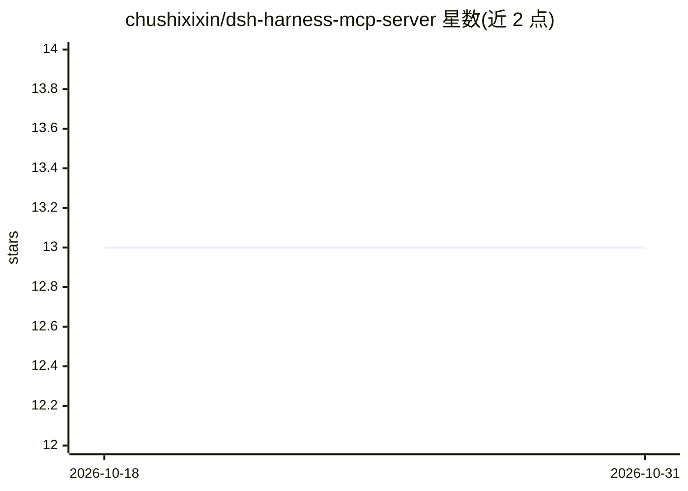

# chushixixin/dsh-harness-mcp-server

⭐ 13 · TypeScript · MIT · 推送 2026-08-15 · [GitHub](https://github.com/chushixixin/dsh-harness-mcp-server) · 个人维护

**把 DeepSeek Harness agent 能力暴露为 MCP 服务器的插件**

面向 DeepSeek Harness（Cordis 应用）的插件：在 Harness 内部启动一个 StreamableHTTP MCP 服务器，桥接其 agents、agentPresets、tools 等核心服务，供外部 MCP 客户端（如 Hermes）通过 agent_run、task_inbox、task_result 等工具把编码任务委托给 Harness 执行，返回结构化结果（changes/verification/leftovers）。任务会话按 cwd 复用，Bash 默认沙箱运行（需安装 bubblewrap）。定位为上下文隔离与并行执行的备用工具，非日常主力。支持 npm 安装或源码构建。

## 筛选速览

| 维度 | 判定 | 备注 |
|---|---|---|
| AI 角色 | `ai-ecosystem` | LLM/agent 周边工具 |
| 许可风险 | `permissive` | MIT |
| 部署形态 | `library` | 以包/库形式分发 |
| 模型依赖 | — | README 未给出锁定关系 |
| 硬件要求 | — | 无带数字的原话,不猜 |
| 安装摩擦 | `low` | 无编译、无系统依赖或容器化 |
| 成熟度 | — | 结构信号不足 |

## 能力要点

- 在 Harness 内启动 MCP 服务器并桥接核心服务（agents/tools/presets）
- agent_run 同步执行与 task_inbox/task_result 异步队列两种任务模式
- 任务会话按 cwd 复用，避免每次重载项目上下文
- 默认仅绑定 127.0.0.1，README 明确警告未认证远程执行风险

## 适用场景

- 让外部 MCP 客户端（如 Hermes）委托 Harness 执行真实编码任务
- 大型重构时做上下文隔离，避免撑爆客户端上下文
- 并行执行多个互不相关的编码任务

## 场景标签

`编码 Agent` · 领域:编码与开发

## 证据(README 行号)

> L3: > Expose DeepSeek Harness agent capabilities as an **MCP server**, letting any MCP client (e.g. Hermes) drive Harnes
> L12: Harness ships a powerful agent runtime (tools, LLM, agents, sessions), but it is a **Cordis app**, not something an
> L27: |`agent_run`|Hermes → Harness|Run a task synchronously and return a structured result|

## 星数曲线

2026-10-18 13 → 2026-10-31 13（+0）

---
*卡片 v1 · prompt 1.4 · 生成 2026-10-31 · 置信度 high · 依据 README sha `ccd0e0690ef3` · [字段定义](../../DATASET.md)*
