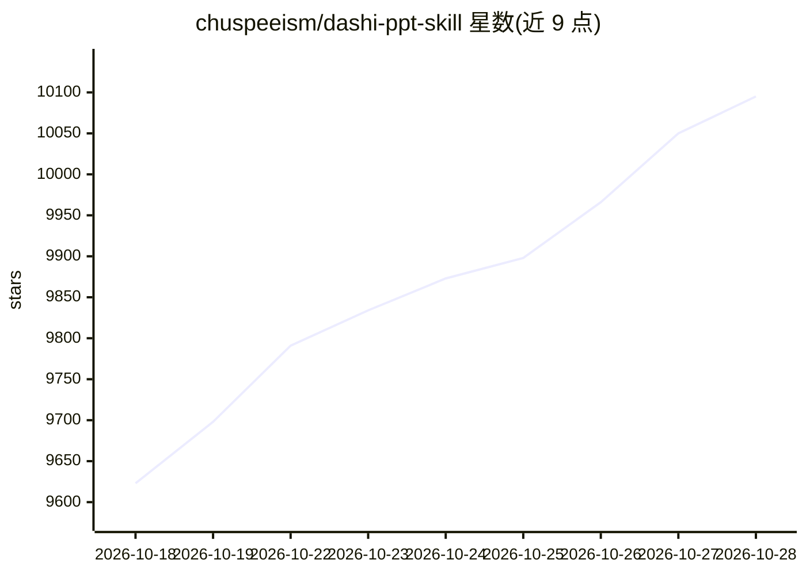

# chuspeeism/dashi-ppt-skill

⭐ 10,132 · JavaScript · AGPL-3.0 · 推送 2026-09-12 · [GitHub](https://github.com/chuspeeism/dashi-ppt-skill) · 个人维护 · 中文 README

**给 AI Agent 用的 PPT 生成技能：文档转可编辑演示文稿**

面向职场用户的 AI agent 技能（SKILL.md 形式）：把文档交给 AI Agent 后生成网页版 PPT，含 12 套视觉主题、1020 个版式页面、8576 个可调控件。生成的每页自带浏览器编辑控制台（改文字、换图、调布局/配色/模块数量），可一键导出 HTML 离线包、PDF 与可编辑 PPTX。支持 Claude Code、Codex、豆包等已实测平台；需 Node.js 20+，导出需本机 Chrome/Chromium/Edge。主项目 AGPL-3.0，导出引擎子包为专有组件，另提供商业授权联系渠道。

## 筛选速览

| 维度 | 判定 | 备注 |
|---|---|---|
| AI 角色 | `ai-native` | 本体是模型或模型工具 |
| 许可风险 | `dual` | AGPL-3.0 |
| 部署形态 | `library` | 以包/库形式分发 |
| 模型依赖 | — | README 未给出锁定关系 |
| 硬件要求 | — | 无带数字的原话,不猜 |
| 安装摩擦 | `low` | 无编译、无系统依赖或容器化 |
| 成熟度 | — | 结构信号不足 |

## 能力要点

- 12 套主题 / 1020 个版式 / 8576 个可调控件
- 每页自带浏览器编辑控制台，文字点击即改
- 一键导出 HTML / PDF / 可编辑 PPTX
- 内容零上传，生成、编辑、导出均在本地完成

## 适用场景

- 把行研报告、项目汇报文档快速转成结构完整的 PPT
- 生成后在浏览器里就地调整布局、配色与内容再导出
- 让 Agent 一步直接产出 PPTX 格式文件

## 场景标签

 · 领域:办公/演示文稿生成

## 证据(README 行号)

> L18: 一个真正适合职场人的 PPT Skill。把文档丢给你的 AI Agent，每一页都自带编辑控制台的 PPT Skill——不满意的地方直接在浏览器里改，改完还能一键导出成真实的、可编辑的 PPTX。
> L92: |Claude Code|支持||
> L95: |Marvis / Workbuddy / Dumate / Qclaw|支持|skill 文件放在任意位置、读取 `SKILL.md` 即可|

## 星数曲线

2026-10-18 9,623 → 2026-10-28 10,095（+472）

---
*卡片 v1 · prompt 1.4 · 生成 2026-10-20 · 置信度 high · 依据 README sha `982e79731fef` · [字段定义](../../DATASET.md)*
