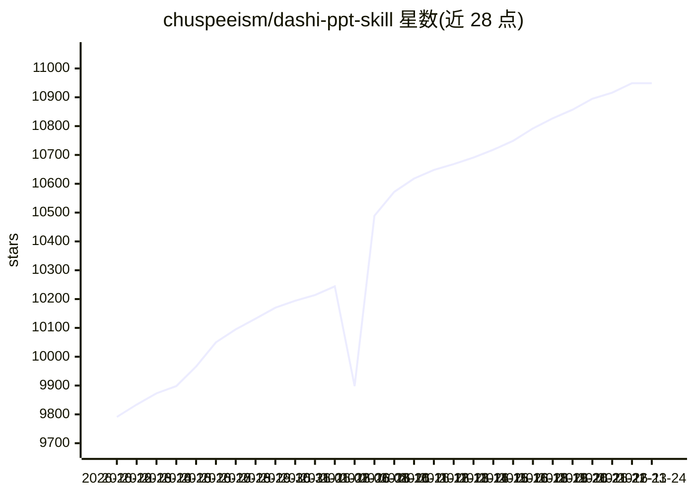

# chuspeeism/dashi-ppt-skill

⭐ 10,949 · JavaScript · AGPL-3.0 · 推送 2026-11-06 · [GitHub](https://github.com/chuspeeism/dashi-ppt-skill) · 个人维护 · 中文 README

**让 AI Agent 从文档生成可浏览器编辑、可导出 PPTX 的技能包**

面向职场人的 AI Agent 技能（skill）：把文档交给 Claude Code、Codex、豆包等本地 Agent，自动组稿生成带 12 套视觉主题、1020 个版式的演示文稿。每页附带浏览器编辑控制台，可拖滑杆调整模块数量、布局、配色，点击就地改文字、替换媒体，最终导出为 HTML 离线包、PDF 或逐节点可编辑的 PPTX。安装需 Node.js 20+，导出依赖本机 Chrome/Chromium/Edge；生成与编辑全程在本机完成。

## 筛选速览

| 维度 | 判定 | 备注 |
|---|---|---|
| AI 角色 | `ai-native` | 本体是模型或模型工具 |
| 许可风险 | `dual` | AGPL-3.0 |
| 部署形态 | `library` | 以包/库形式分发 |
| 模型依赖 | — | README 未给出锁定关系 |
| 硬件要求 | — | 无带数字的原话,不猜 |
| 安装摩擦 | `low` | 无编译、无系统依赖或容器化 |
| 成熟度 | — | 结构信号不足 |

## 能力要点

- 12 套视觉主题、1020 个版式页面、20 种页面角色
- 浏览器内编辑控制台：滑杆调节布局、模块数量、配色与页面重点
- 一键导出 HTML 离线包 / PDF / 逐节点可编辑的 PPTX
- 内容零上传：生成、编辑、导出均在本机完成

## 适用场景

- 把行业研究或竞品分析文档快速变成结构完整的演示文稿
- 路演或项目汇报材料生成后在浏览器里继续改细节
- 需要可继续编辑的真实 PPTX 文件交付给同事

## 场景标签

 · 领域:办公效率/演示文稿生成

## 证据(README 行号)

> L18: 一个真正适合职场人的 PPT Skill。把文档丢给你的 AI Agent，每一页都自带编辑控制台的 PPT Skill——不满意的地方直接在浏览器里改，改完还能一键导出成真实的、可编辑的 PPTX。
> L72: - **一键导出**：HTML离线包 / PDF / 可编辑 PPTX
> L97: |Claude Code|支持||

## 星数曲线

2026-10-22 9,791 → 2026-11-24 10,949（+1,158）

---
*卡片 v1 · prompt 1.4 · 生成 2026-11-22 · 置信度 high · 依据 README sha `950a3b3eaeba` · [字段定义](../../DATASET.md)*
