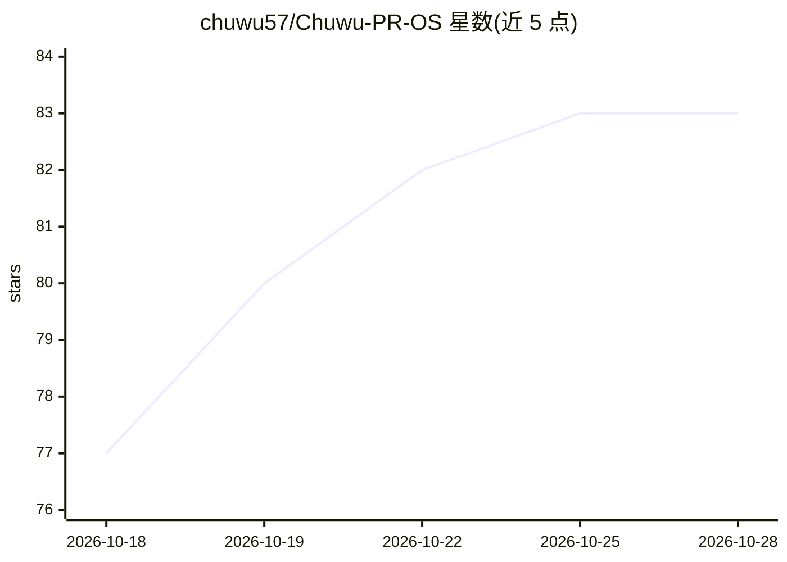

# chuwu57/Chuwu-PR-OS

⭐ 83 · Python · MIT · 推送 2026-10-15 · [GitHub](https://github.com/chuwu57/Chuwu-PR-OS) · 个人维护 · 中文 README

**公关、研究与知识维护的14项Agent Skill合集（方法/参考/模板/脚本）**

由初五整理维护的Skill合集，含8项公关、3项研究、3项知识与维护，覆盖年度公关战略、舆情分析、通稿起草、消费者研究、口述内容提取等。每项Skill由SKILL.md格式的方法、参考资料、模板与辅助脚本组成，在支持SKILL.md的Agent工具中读取调用，另有WorkBuddy合集入口版本。强调从真实材料出发、区分事实与假设、资料不足时说明缺口不虚构；最新事实核验需联网工具，音视频转写需相应运行依赖。MIT许可，未完成WorkBuddy实际导入与全部任务验证。

## 筛选速览

| 维度 | 判定 | 备注 |
|---|---|---|
| AI 角色 | `ai-knowledge` | 知识聚合/清单类 |
| 许可风险 | `permissive` | MIT |
| 部署形态 | `None` |  |
| 模型依赖 | — | README 未给出锁定关系 |
| 硬件要求 | — | 无带数字的原话,不猜 |
| 安装摩擦 | `low` | 无编译、无系统依赖或容器化 |
| 成熟度 | `idea` | |

## 能力要点

- 14项Skill按公关/研究/知识与维护三类组织，含调用名与解决的问题对照表
- 每项含方法、参考、模板与辅助脚本，仅复制SKILL.md会丢失参考和脚本
- 强调事实/解释/假设区分与证据边界，资料不足时说明缺口不虚构
- skill-evolution 由用户明确启动维护Skill并保存版本，不自动后台自我进化

## 适用场景

- 让Agent按专项方法起草新闻通稿或公关预案
- 为消费者研究设计访谈题纲与研究方案
- 从播客、演讲等口述内容中提取整理要点

## 场景标签

`提示工程` `AI 写作` · 领域:Agent 开发

## 证据(README 行号)

> L3: PROS 05由初五整理维护，包含14项Skill：8项公关、3项研究、3项知识与维护。它将公关工作中需要反复判断的问题，整理为Agent可按任务读取的方法、参考资料、模板和辅助脚本。
> L40: 在支持SKILL.md的Agent工具中读取对应专项，或通过WorkBuddy合集入口按任务调用。先看依赖与使用范围，保留完整目录；只复制SKILL.md会丢失参考和脚本。

## 星数曲线

2026-10-18 77 → 2026-10-28 83（+6）

---
*卡片 v1 · prompt 1.4 · 生成 2026-10-24 · 置信度 high · 依据 README sha `75081dc9e9d4` · [字段定义](../../DATASET.md)*
