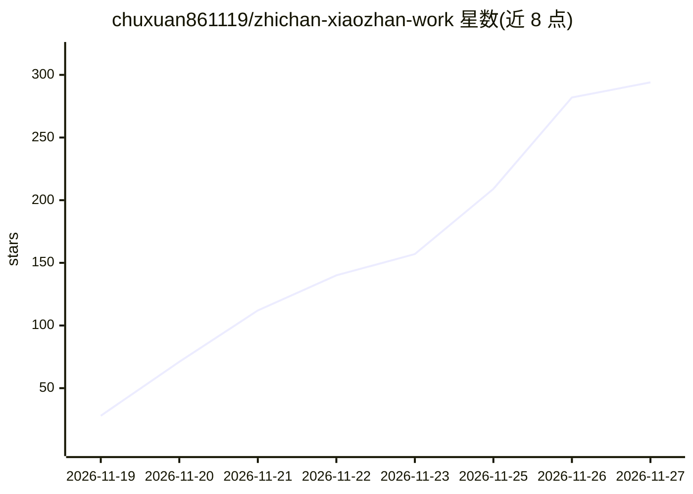

# chuxuan861119/zhichan-xiaozhan-work

⭐ 294 · TypeScript · GPL-3.0 · 推送 2026-11-22 · [GitHub](https://github.com/chuxuan861119/zhichan-xiaozhan-work) · [官网](https://zcxzz.cn/work/) · 组织维护 · 中文 README

**中国专利撰写工作台：五书、附图、CAD、修图一站式本地编辑**

面向中国专利撰写的 Electron 桌面编辑器，覆盖发明专利、实用新型与外观设计：五书多标签与双文档对照、部件标记登记、二维 CAD 标注（DWG/DXF）、分层修图（适配 Klecks 内核）、流程图与电路图、公式与化学结构式编辑。提供本地规则检查、DOCX/PDF/PATDOC 导出、快照与加密整库迁移。核心功能离线本地运行，AI 纠错与对话助手为实验功能，需用户自行配置 DeepSeek API；Agent CLI 默认关闭。GPL-3.0 开源。

## 筛选速览

| 维度 | 判定 | 备注 |
|---|---|---|
| AI 角色 | `ai-enhanced` | 去掉 AI 部分产品仍成立 |
| 许可风险 | `viral` | GPL-3.0 |
| 部署形态 | `None` |  |
| 模型依赖 | locked-api |  |
| 硬件要求 | — | 无带数字的原话,不猜 |
| 安装摩擦 | `low` | 无编译、无系统依赖或容器化 |
| 成熟度 | — | 结构信号不足 |

## 能力要点

- 五书同屏对照编辑与权项/说明书撰写辅助、部件标记登记
- 二维 CAD 标注（DWG/DXF 导入导出）与分层修图（PSD 兼容）
- 本地规则检查权项编号、章节、术语与附图标记
- 版本快照、PATDOC 定时备份与加密整库迁移

## 适用场景

- 集中管理多件专利，对照五书完成撰写与交付整理
- 制作外观设计六视图、简要说明并导出白底 JPG 材料
- 处理 DWG/DXF 图纸生成说明书附图
- 本地检查权项编号引用与附图标记一致性问题

## 场景标签

`AI 写作` · 领域:内容生成

## 证据(README 行号)

> L7: 知产小栈 Work 是面向中国专利撰写的专业编辑器，支持发明专利、实用新型专利和外观设计专利。可以在本地管理案件，编写专利五书、制作附图和二维 CAD 标注，也可以整理外观设计图片、编写简要说明并导出材料。
> L38: |检查与 AI|本地规则检查、AI 纠错、对话助手、授权的 Agent CLI|
> L191: 本版本对接用户自行配置的 DeepSeek 官方 API，需用户自行取得并填写 API Key，服务费用与使用条件以服务商规定为准。AI 连接默认关闭；启用后，任务所需内容会发送至所配置的服务商。请自行判断未公开技术资料的提交范

## 星数曲线

2026-11-19 28 → 2026-11-27 294（+266）

---
*卡片 v1 · prompt 1.4 · 生成 2026-11-26 · 置信度 high · 依据 README sha `e7b49960727a` · [字段定义](../../DATASET.md)*
