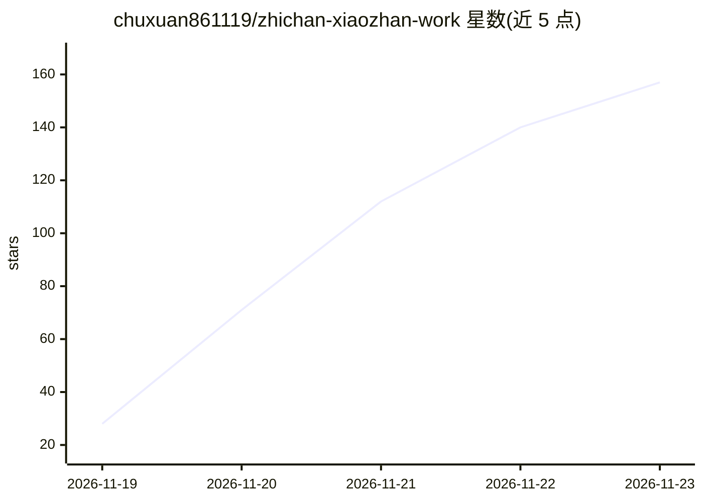

# chuxuan861119/zhichan-xiaozhan-work

⭐ 157 · TypeScript · GPL-3.0 · 推送 2026-11-22 · [GitHub](https://github.com/chuxuan861119/zhichan-xiaozhan-work) · [官网](https://zcxzz.cn/work/) · 组织维护 · 中文 README

**面向专利代理师的中国专利五书撰写与文档管理桌面工作台**

Electron/React/TypeScript 构建的 Windows 桌面软件，围绕发明专利与实用新型提供专利库管理、五书多标签编辑与双文档对照、二维 CAD 标注（DWG/DXF）、表格公式化学结构式、流程图电路图、本地规则检查，以及 DOCX/PDF/PATDOC 导出打印。核心功能本地离线运行，无需注册账号；AI 纠错与对话助手为实验性可选功能，需用户自行配置 DeepSeek API Key，另有供外部 AI Agent 接入的 CLI，默认关闭并按专利授权。开源版本 1.1.8 不含外观设计工作台。

## 筛选速览

| 维度 | 判定 | 备注 |
|---|---|---|
| AI 角色 | `ai-enhanced` | 去掉 AI 部分产品仍成立 |
| 许可风险 | `viral` | GPL-3.0 |
| 部署形态 | `None` |  |
| 模型依赖 | locked-api |  |
| 硬件要求 | — | 无带数字的原话,不猜 |
| 安装摩擦 | `low` | 无编译、无系统依赖或容器化 |
| 成熟度 | — | 结构信号不足 |

## 能力要点

- 五书多标签编辑与权利要求/说明书同屏对照
- 二维 CAD 工作区处理 DWG/DXF 并生成说明书附图
- 本地规则检查权项编号、章节、术语与附图标记，无需 AI 配置
- Agent CLI 在用户授权范围内让外部 AI Agent 操作专利资料

## 适用场景

- 集中管理多件专利并撰写五书、处理附图与交付导出
- 整理技术方案、参数表、公式和化学结构式
- 按 GPL-3.0 研究桌面编辑器、规则检查与 Agent CLI 的实现

## 场景标签

`AI 写作` `知识库管理` · 领域:内容生成

## 证据(README 行号)

> L7: 知产小栈 Work 是面向中国专利撰写场景的桌面软件，围绕发明专利与实用新型专利，提供专利库管理、专利五书编辑、附图制作、二维 CAD 标注、本地规则检查、AI 辅助，以及 Word、PDF 等格式的导入导出能力。
> L163: 本版本对接用户自行配置的 DeepSeek 官方 API，需用户自行取得并填写 API Key，服务费用与使用条件以服务商规定为准。AI 连接默认关闭；启用后，任务所需内容会发送至所配置的服务商。请自行判断未公开技术资料的提交范
> L171: 软件不随附 API Key 或免费调用额度，本版本暂不支持任意自定义接口或 Ollama。AI 是可选辅助，关闭连接后仍可进行本地撰写。

## 星数曲线

2026-11-19 28 → 2026-11-23 157（+129）

---
*卡片 v1 · prompt 1.4 · 生成 2026-11-19 · 置信度 high · 依据 README sha `bdf07fde866d` · [字段定义](../../DATASET.md)*
