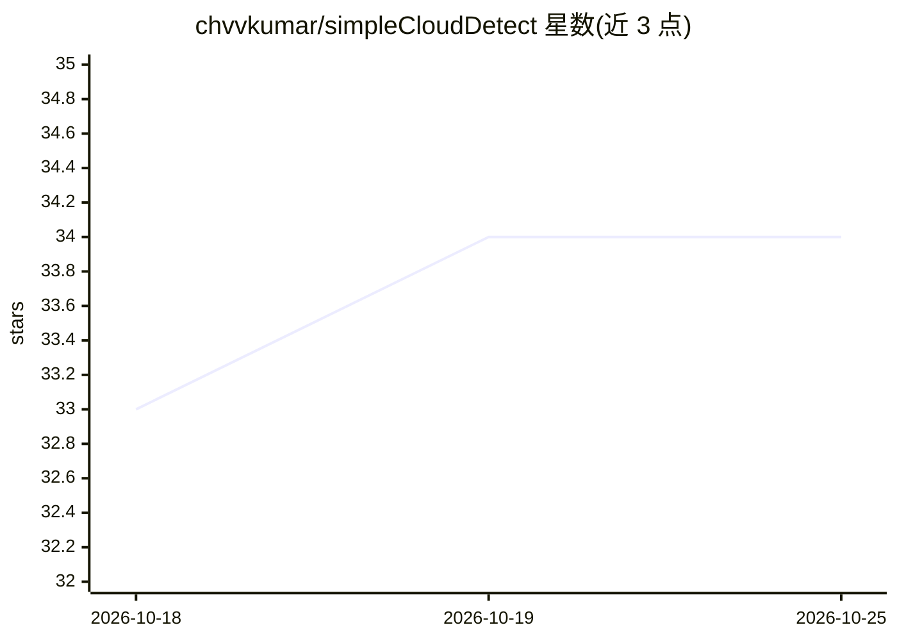

# chvvkumar/simpleCloudDetect

⭐ 34 · Python · 推送 2026-10-12 · [GitHub](https://github.com/chvvkumar/simpleCloudDetect) · 个人维护

**给天文摄影者的全天候相机云量 ML 检测服务（MQTT/ASCOM）**

基于机器学习的 AllSky 相机云量分类系统：读取 URL 或本地图片，用 Keras 模型（keras_model.h5）分类为 Clear/Wisps/Mostly Cloudy/Overcast/Rain/Snow 六种状态，输出置信度与处理耗时。通过 MQTT Discovery 自动接入 Home Assistant，内置 ASCOM Alpaca SafetyMonitor（Interface Version 3）供 N.I.N.A.、SGP、TheSkyX 等天文软件调用，并提供外部 REST API。含图像哈希不变与检测失败的失效保护机制，超时即报 unsafe。以 Docker 多架构镜像（AMD64/ARM64）分发，支持自定义模型。

## 筛选速览

| 维度 | 判定 | 备注 |
|---|---|---|
| AI 角色 | `ai-native` | 本体是模型或模型工具 |
| 许可风险 | `none` | — |
| 部署形态 | `self-host` | docker 或自建部署 |
| 模型依赖 | — | README 未给出锁定关系 |
| 硬件要求 | — | 无带数字的原话,不猜 |
| 安装摩擦 | `low` | 无编译、无系统依赖或容器化 |
| 成熟度 | — | 结构信号不足 |

## 能力要点

- 六类天空状态 ML 分类，输出置信度与耗时
- MQTT Discovery 自动接入 Home Assistant，或 legacy 手动配置
- 内置 ASCOM Alpaca SafetyMonitor（v3），兼容 N.I.N.A./SGP/TheSkyX
- 图像哈希与检测失败的 stale 失效保护，超时报 unsafe

## 适用场景

- 天文摄影自动化中作为安全监控，云量超标时自动停止拍摄
- 在 Home Assistant 中显示天空状态与安全传感器的家庭天气监控
- 通过 REST API 接入自制仪表盘或监控系统

## 场景标签

`目标检测` · 领域:感知与多模态

## 证据(README 行号)

> L3: A Machine Learning-based cloud detection system for AllSky cameras with MQTT and ASCOM Alpaca SafetyMonitor integrat
> L15: - **ML Cloud Classification** - Detects Clear, Wisps, Mostly Cloudy, Overcast, Rain, and Snow conditions

## 星数曲线

2026-10-18 33 → 2026-10-25 34（+1）

---
*卡片 v1 · prompt 1.4 · 生成 2026-10-25 · 置信度 high · 依据 README sha `7177f5cced9a` · [字段定义](../../DATASET.md)*
