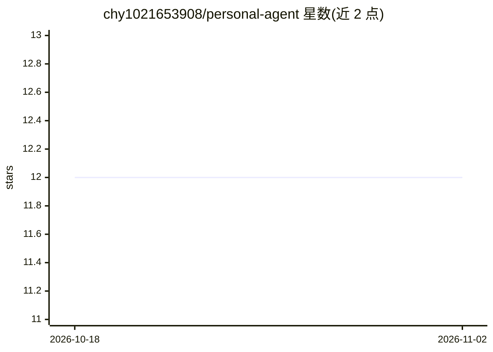

# chy1021653908/personal-agent

⭐ 12 · TypeScript · MIT · 推送 2026-05-28 · [GitHub](https://github.com/chy1021653908/personal-agent) · [官网](https://personal-agent-github.vercel.app) · 个人维护 · 中文 README

**面向个人与团队的自托管 AI 知识助手：对话、RAG 问答与网络调研**

基于 LangChain/LangGraph 与 Next.js 的全栈 AI 应用，供团队和个人自部署使用：多轮对话、上传 PDF/TXT/Markdown/DOCX/XLSX 文件做基于检索的问答、通过 LangGraph 分步网络搜索工作流处理时效性话题，并支持知识库文件夹组织、会话持久化、邮箱与 Google 登录及用户级数据隔离。运行需 Node.js 22+、pnpm 9+、PostgreSQL 与 Chroma，配置需自备 LLM provider key 与可选的网页搜索 key。

## 筛选速览

| 维度 | 判定 | 备注 |
|---|---|---|
| AI 角色 | `ai-native` | 本体是模型或模型工具 |
| 许可风险 | `permissive` | MIT |
| 部署形态 | `library` | 以包/库形式分发 |
| 模型依赖 | — | README 未给出锁定关系 |
| 硬件要求 | — | 无带数字的原话,不猜 |
| 安装摩擦 | `low` | 无编译、无系统依赖或容器化 |
| 成熟度 | — | 结构信号不足 |

## 能力要点

- 多知识库 RAG 问答，支持 PDF/TXT/MD/DOCX/XLSX 上传与自动索引
- LangGraph 分步网络调研工作流，规划/搜索/合成过程可见
- 会话与检索上下文跨会话持久化
- 邮箱/Google 登录与用户级数据隔离，中英双语界面

## 适用场景

- 我把团队文档上传成知识库，直接提问获得带出处的回答
- 需要最新网络信息时切换到网络调研工作流
- 个人资料的多轮追问式知识问答

## 场景标签

`RAG` `文档问答` `聊天机器人` · 领域:对话与助手

## 证据(README 行号)

> L3: An AI knowledge assistant for team and personal use, built for practical workflows:
> L17: - chat with an AI assistant in a multi-turn conversation
> L18: - upload your own files and ask questions grounded in those files

## 星数曲线

2026-10-18 12 → 2026-11-02 12（+0）

---
*卡片 v1 · prompt 1.4 · 生成 2026-11-01 · 置信度 high · 依据 README sha `5e857dc22a9d` · [字段定义](../../DATASET.md)*
