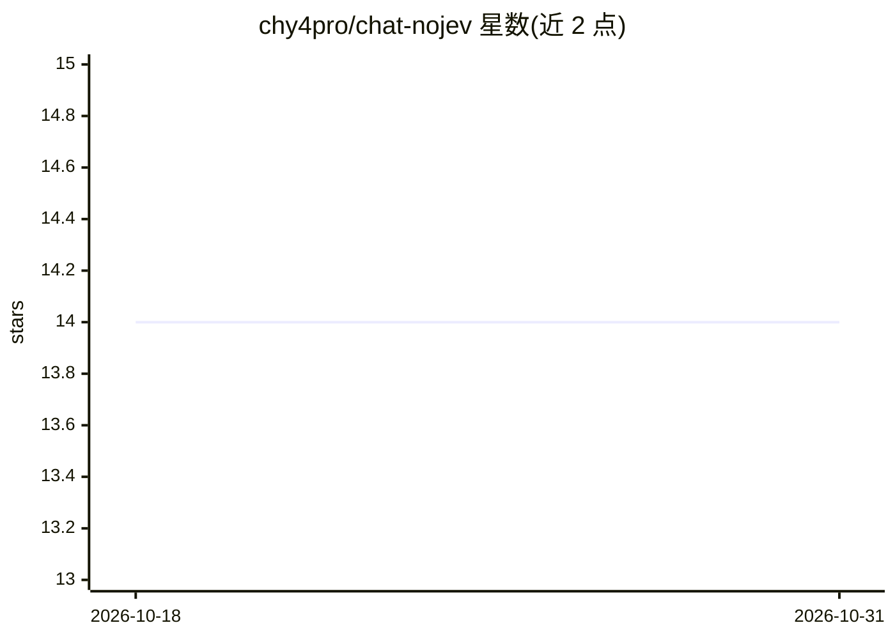

# chy4pro/chat-nojev

⭐ 14 · Python · NOASSERTION · 推送 2026-10-20 · [GitHub](https://github.com/chy4pro/chat-nojev) · 个人维护 · 中文 README

**jev-chat 对话副驾派生版：判断与候选回复合并为单次模型调用**

jev-chat 三个平台版本（Windows/Android/macOS）的派生作品，只改一处：原版由专门判断模型做意图判断与排序，此版由生成候选回复的同一模型在同一次请求里一并输出判断、候选与打分，因此只需配置一把 OpenAI 兼容端点的 key。读取聊天窗口内容、OCR、悬浮窗、填入输入框等均为原版代码。三平台均提供 v0.3.0 构建产物，但作者声明没有任何变体在真机上验证过；Android APK 未签名需自签，macOS 版无签名无公证，且删去了原版本地判断模型。

## 筛选速览

| 维度 | 判定 | 备注 |
|---|---|---|
| AI 角色 | `ai-native` | 本体是模型或模型工具 |
| 许可风险 | `none` | NOASSERTION |
| 部署形态 | `desktop` | 安装包/桌面程序 |
| 模型依赖 | local-ok | 支持本地模型 |
| 硬件要求 | — | 无带数字的原话,不猜 |
| 安装摩擦 | `medium` | 含编译或系统依赖之一 |
| 成熟度 | `idea` | |

## 能力要点

- 判断、起草、排序合并为单次模型调用，只需一把 key
- 三平台（Windows/Android/macOS）各自发布 v0.3.0 构建产物
- 提供与原版的三套差分等价性测试脚本（equivalence_check）
- macOS 版不再内置共享 key，聊天内容只发往用户自配端点

## 适用场景

- 在聊天软件旁生成候选回复并由自己确认填入
- 想用一把 key 同时获得判断和候选排序的 jev-chat 用户
- 与原版 jev-chat 在同一设备上对照使用

## 场景标签

 · 领域:聊天辅助/无障碍工具

## 证据(README 行号)

> L3: **jev-chat 三个版本（Windows / Android / macOS）的派生，只改了一件事：
> L4: 判断和排序不再交给专门的判断模型，而是由写候选回复的那个模型在同一次调用里一并给出。
> L81: 原版的链路是三次调用：专门的判断模型（Jev）回答对方的真实意图、紧张度、该不该马上回，生成模型起草候选回复，判断模型再给候选打分排序。两路接口、两把 key。这一版只发一次请求（macOS 是每个话术一次）：同一个模型答那几道判

## 星数曲线

2026-10-18 14 → 2026-10-31 14（+0）

---
*卡片 v1 · prompt 1.4 · 生成 2026-10-31 · 置信度 high · 依据 README sha `0f0204d3df98` · [字段定义](../../DATASET.md)*
