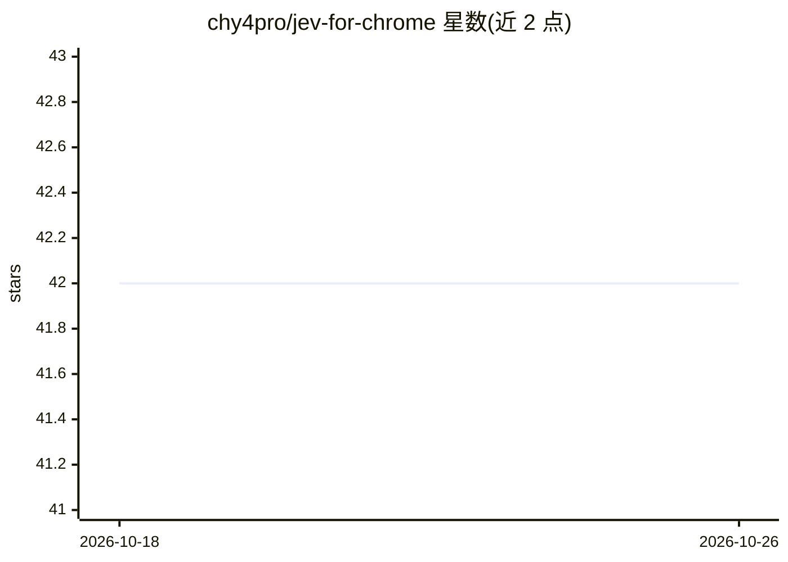

# chy4pro/jev-for-chrome

⭐ 42 · TypeScript · MIT · 推送 2026-10-01 · [GitHub](https://github.com/chy4pro/jev-for-chrome) · 个人维护 · 中文 README

**在当前 Chrome 标签页内由 Jev 决策模型自动操作网页的扩展**

Manifest V3 Chrome 扩展，把 browser-use/jev-ultrafast 移植到用户自己的浏览器标签页：内容脚本读取页面可见元素表（无截图），由 TypeSafe Jev 决策模型在数百毫秒内选择下一个点击/输入/滚动等操作，TYPE_TEXT 时由小型 OpenAI 兼容文本模型生成具体输入串。通过 DevTools 协议派发真实点击与按键，附 Step 单步执行与 Copy trace 导出。Jev 服务需经 OpenRouter/TypeSafe.ai/Cloudflare 接入并配置 key。可用 Chrome Web Store、Release zip 或源码构建安装。

## 筛选速览

| 维度 | 判定 | 备注 |
|---|---|---|
| AI 角色 | `ai-native` | 本体是模型或模型工具 |
| 许可风险 | `permissive` | MIT |
| 部署形态 | `desktop` | 安装包/桌面程序 |
| 模型依赖 | locked-api |  |
| 硬件要求 | — | 无带数字的原话,不猜 |
| 安装摩擦 | `low` | 无编译、无系统依赖或容器化 |
| 成熟度 | — | 结构信号不足 |

## 能力要点

- 在用户已登录的正常 Chrome 配置文件中运行，无需 Python/Playwright
- Jev 单请求决定操作与目标元素，亚秒级决策，不生成文本
- 目标检查与卡滞检查两次独立概率校验可否决过早 DONE/BLOCKED
- 支持 Step 单步执行、元素编号徽标与整次运行 JSON 导出

## 适用场景

- 在已有登录态的网页上让模型代为完成表单、搜索、订票等操作
- 单步观察模型决策过程并导出 trace 排查问题
- 在拒绝自动化浏览器的站点上执行任务

## 场景标签

`浏览器自动化` · 领域:效率与自动化

## 证据(README 行号)

> L10: A Chrome extension that drives the tab you are looking at with TypeSafe Jev, a decision model that picks the next c
> L37: 2. The background worker sends one request to Jev with the goal, the element table and recent actions. Jev answers 
> L38: 3. If the operation is `TYPE_TEXT`, a small chat model (DeepSeek, Gemini, anything OpenAI-compatible) turns the goa

## 星数曲线

2026-10-18 42 → 2026-10-26 42（+0）

---
*卡片 v1 · prompt 1.4 · 生成 2026-10-25 · 置信度 high · 依据 README sha `58180b1be8ed` · [字段定义](../../DATASET.md)*
