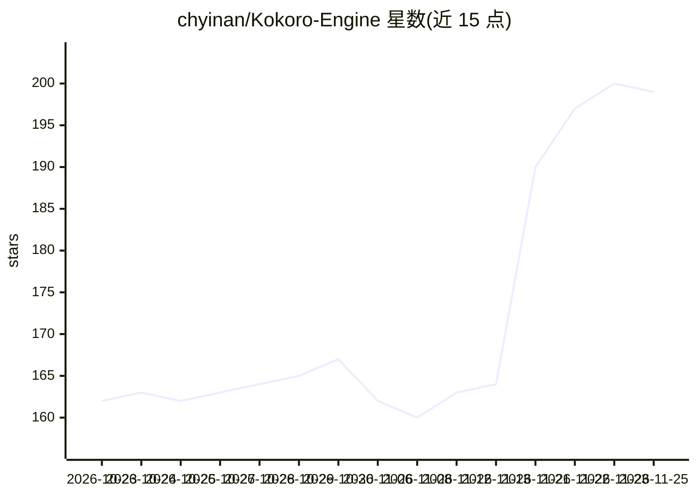

# chyinan/Kokoro-Engine

⭐ 199 · Rust · MIT · 推送 2026-11-23 · [GitHub](https://github.com/chyinan/Kokoro-Engine) · 个人维护 · 中文 README

**桌面 AI 虚拟角色引擎：带形象、语音与长期记忆的沉浸交互**

基于 Tauri v2 + React + Rust 的跨平台桌面角色运行时：集成 Live2D 渲染、LLM 对话、TTS/STT 语音链路、视觉输入与长期记忆（SQLite 混合检索），面向虚拟角色创作者、开发者与普通用户。扩展通过 MOD（HTML/CSS/JS + QuickJS 沙箱）与 MCP Server 实现，支持导入 SillyTavern 角色卡，内置 QQ/Telegram/Discord/LINE/Webhook Bot 服务。提供 Releases 安装包、源码构建与 Nix 三种安装路径；Live2D Cubism SDK 部分受 Live2D 专有许可约束，中大型企业可能需单独商业授权。

## 筛选速览

| 维度 | 判定 | 备注 |
|---|---|---|
| AI 角色 | `ai-native` | 本体是模型或模型工具 |
| 许可风险 | `permissive` | MIT |
| 部署形态 | `library` | 以包/库形式分发 |
| 模型依赖 | local-ok | 支持本地模型 |
| 硬件要求 | — | 无带数字的原话,不猜 |
| 安装摩擦 | `low` | 无编译、无系统依赖或容器化 |
| 成熟度 | — | 结构信号不足 |

## 能力要点

- Live2D 渲染、LLM、TTS、STT 集成于单一运行时闭环
- 记忆层基于 SQLite，embedding + FTS5 BM25 + RRF 混合检索
- MOD 框架（QuickJS 沙箱）与 MCP Server 外部工具调用
- 内置 QQ、Telegram、Discord、LINE、Webhook 五种 Bot 服务

## 适用场景

- 在桌面上运行有形象和长期记忆的 AI 角色进行对话
- 导入 SillyTavern 角色卡，用不同人格延续各自对话
- 让桌面角色根据屏幕内容或语音输入作出反应
- 通过 QQ/Telegram 等平台 Bot 远程接入角色

## 场景标签

`聊天机器人` `Agent 记忆` · 领域:Agent 开发

## 证据(README 行号)

> L6:  在桌面上运行有形象、有声音、有长期记忆的 AI 角色。
> L31: Kokoro Engine 不是“聊天壳子 + 桌宠皮肤”。它是一个完整的桌面角色运行时：
> L33: - **All-in-one**：Live2D、LLM、TTS、STT等技术集成在一个运行时闭环。

## 星数曲线

2026-10-23 162 → 2026-11-25 199（+37）

---
*卡片 v1 · prompt 1.4 · 生成 2026-11-25 · 置信度 high · 依据 README sha `776c3696d9de` · [字段定义](../../DATASET.md)*
