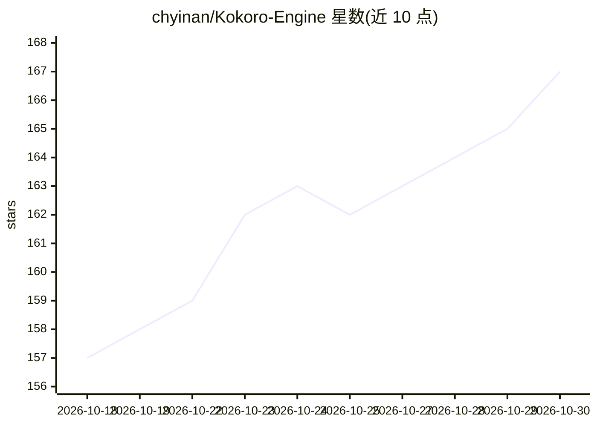

# chyinan/Kokoro-Engine

⭐ 167 · Rust · MIT · 推送 2026-10-29 · [GitHub](https://github.com/chyinan/Kokoro-Engine) · 个人维护 · 中文 README

**桌面 AI 角色运行时：有形象、声音与长期记忆的虚拟角色交互**

基于 Tauri v2 + React 19 + Rust 构建的跨平台桌面虚拟角色引擎：集成 Live2D 渲染、LLM 对话（支持 Ollama、llama.cpp 及 OpenAI/Anthropic 兼容 API）、TTS/STT、长期记忆（SQLite + embedding + FTS5 BM25 + RRF 混合检索）与情感状态。支持 MOD 框架（HTML/CSS/JS + QuickJS 沙箱）、MCP Server 接入、SillyTavern 角色卡导入，并内置 QQ/Telegram/Discord/LINE/Webhook 五种 Bot 桥接。面向虚拟角色创作者、开发者与普通用户，本地优先存储。当前内置三个角色；Live2D 部分受 Live2D Inc. 许可约束。

## 筛选速览

| 维度 | 判定 | 备注 |
|---|---|---|
| AI 角色 | `ai-native` | 本体是模型或模型工具 |
| 许可风险 | `permissive` | MIT |
| 部署形态 | `library` | 以包/库形式分发 |
| 模型依赖 | local-ok | 支持本地模型 |
| 硬件要求 | — | 无带数字的原话,不猜 |
| 安装摩擦 | `low` | 无编译、无系统依赖或容器化 |
| 成熟度 | `idea` | |

## 能力要点

- Live2D 渲染 + LLM/TTS/STT 集成在单一桌面运行时
- 长期记忆：SQLite 混合检索（embedding + FTS5 BM25 + RRF）与梦境整理
- MOD 框架（QuickJS 沙箱）与 MCP Server 扩展
- QQ/Telegram/Discord/LINE/Webhook 五种 Bot 服务接入

## 适用场景

- 在桌面养一个会说话、有记忆的 AI 虚拟角色
- 导入 SillyTavern 角色卡延续不同人格的对话
- 把桌面角色接到 QQ/Telegram 等 Bot 平台远程互动

## 场景标签

`聊天机器人` `Agent 记忆` `语音合成` · 领域:Agent 开发

## 证据(README 行号)

> L6:  在桌面上运行有形象、有声音、有长期记忆的 AI 角色。
> L33: - **All-in-one**：Live2D、LLM、TTS、STT等技术集成在一个运行时闭环。
> L106: - 支持 Ollama 、llama.cpp 与 OpenAI 、Anthropic 兼容协议API接口

## 星数曲线

2026-10-18 157 → 2026-10-30 167（+10）

---
*卡片 v1 · prompt 1.4 · 生成 2026-10-22 · 置信度 high · 依据 README sha `3d6babf18b6b` · [字段定义](../../DATASET.md)*
