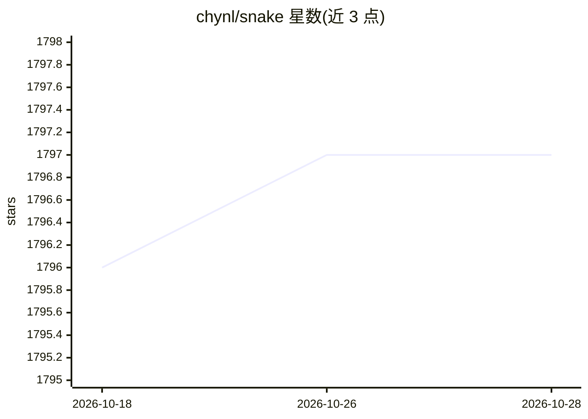

# chynl/snake

⭐ 1,797 · Python · MIT · 推送 2026-04-19 · [GitHub](https://github.com/chynl/snake) · 个人维护

**用图搜索与深度强化学习两种算法自动玩贪吃蛇**

实现两种自动玩贪吃蛇的 AI 算法：一是基于图搜索的规则策略，将 6x6 网格建模为图，依次尝试哈密顿路径、最短安全路径、更长路径与远离食物的移动；二是基于 Double DQN 的深度强化学习，用卷积网络与全连接层逼近动作值函数，提供预训练模型与训练脚本。README 给出 1000 局测试下两算法的平均长度与成功率（94% 与 50%）。需 Python >= 3.10，强化学习部分依赖 PyTorch，支持 CPU 与 GPU。

## 筛选速览

| 维度 | 判定 | 备注 |
|---|---|---|
| AI 角色 | `ai-native` | 本体是模型或模型工具 |
| 许可风险 | `permissive` | MIT |
| 部署形态 | `library` | 以包/库形式分发 |
| 模型依赖 | — | README 未给出锁定关系 |
| 硬件要求 | — | 无带数字的原话,不猜 |
| 安装摩擦 | `low` | 无编译、无系统依赖或容器化 |
| 成熟度 | — | 结构信号不足 |

## 能力要点

- 图搜索策略：哈密顿路径、最短路径安全检查、更长路径重排网格等多级决策
- Double DQN 深度强化学习：4 通道 6x6 卷积张量 + 1D 特征的状态表示，三动作空间
- 提供预训练模型与 rl_train.py 训练入口
- 1000 局测试报告：图搜索成功率 94%，强化学习 50%

## 适用场景

- 学习图搜索与哈密顿路径在游戏求解中的应用
- 学习/实验 Double DQN 强化学习训练流程
- 对比规则算法与强化学习在同类问题上的表现

## 场景标签

`强化学习` · 领域:训练与推理

## 证据(README 行号)

> L3: This project implements two AI algorithms to play the game of snake):
> L79: Reinforcement learning is a machine learning paradigm where an agent learns to make decisions by taking actions in 

## 星数曲线

2026-10-18 1,796 → 2026-10-28 1,797（+1）

---
*卡片 v1 · prompt 1.4 · 生成 2026-10-21 · 置信度 mid · 依据 README sha `731d4c5e776a` · [字段定义](../../DATASET.md)*
