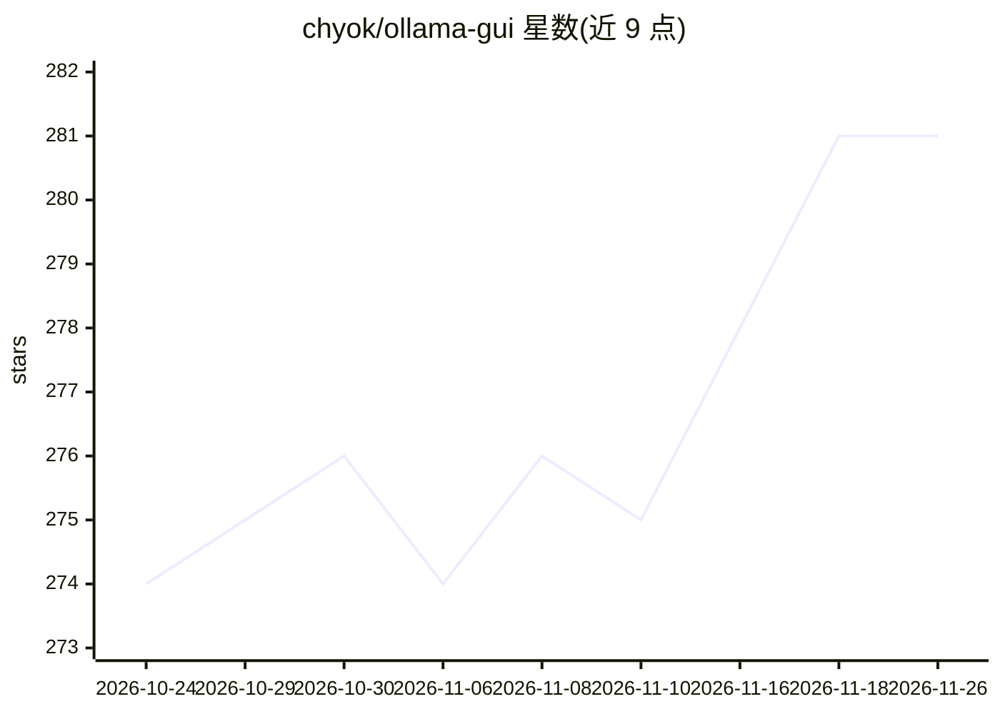

# chyok/ollama-gui

⭐ 281 · Python · MIT · 推送 2026-11-10 · [GitHub](https://github.com/chyok/ollama-gui) · [官网](https://chyok.github.io/ollama-gui/) · 个人维护

**给本地 Ollama 用户的单文件 Tkinter 图形聊天界面**

基于 Python 内置 Tkinter 实现的 Ollama 图形客户端，单文件、无外部依赖。功能包括自动获取模型列表、自定义 Ollama 主机地址、多会话对话、气泡主题、可编辑会话历史、保存/加载历史记录、随时停止生成，以及模型下载与删除管理。支持显示推理模型的思考过程与 Ollama 返回的错误信息。需先自行部署 Ollama 服务；提供源码、pip 安装包与 Windows/macOS/Linux 二进制下载。macOS Sonoma 存在 Tcl/Tk 兼容问题的说明。

## 筛选速览

| 维度 | 判定 | 备注 |
|---|---|---|
| AI 角色 | `ai-ecosystem` | LLM/agent 周边工具 |
| 许可风险 | `permissive` | MIT |
| 部署形态 | `library` | 以包/库形式分发 |
| 模型依赖 | local-ok | 支持本地模型 |
| 硬件要求 | — | 无带数字的原话,不猜 |
| 安装摩擦 | `low` | 无编译、无系统依赖或容器化 |
| 成熟度 | — | 结构信号不足 |

## 能力要点

- 单文件实现，仅依赖系统自带的 tkinter
- 模型管理：下载与删除模型
- 多会话、可编辑并保存/加载会话历史
- 显示推理模型的思考过程并可随时停止生成

## 适用场景

- 不想用命令行与本地 Ollama 模型对话
- 在多个会话中管理并保存与模型的对话历史
- 远程连接自定义地址上的 Ollama 服务

## 场景标签

`聊天机器人` · 领域:对话与助手

## 证据(README 行号)

> L7: A very simple ollama GUI, implemented using the built-in Python Tkinter library, with no additional dependencies.
> L35: We need to set up Ollama service first.

## 星数曲线

2026-10-24 274 → 2026-11-26 281（+7）

---
*卡片 v1 · prompt 1.4 · 生成 2026-11-25 · 置信度 high · 依据 README sha `15f22bfce8de` · [字段定义](../../DATASET.md)*
