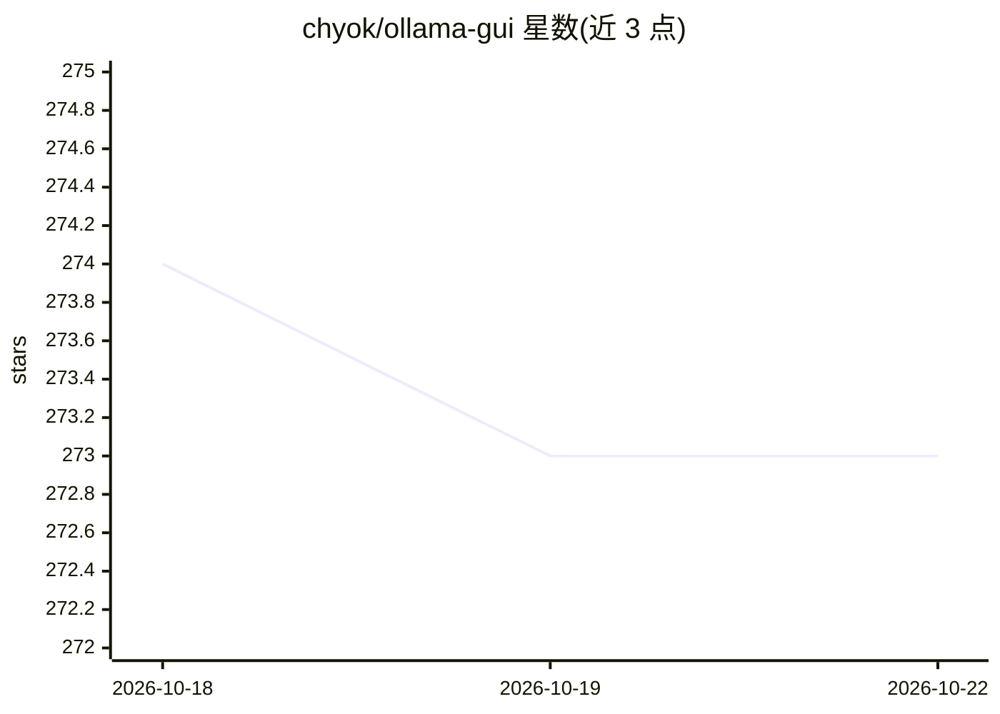

# chyok/ollama-gui

⭐ 273 · Python · MIT · 推送 2025-11-20 · [GitHub](https://github.com/chyok/ollama-gui) · [官网](https://chyok.github.io/ollama-gui/) · 个人维护

**单文件 Tkinter 实现的 Ollama 图形聊天界面**

基于 Python 内置 Tkinter 的 Ollama 桌面 GUI，整个项目为单个 Python 文件，除通常随 Python 附带的 tkinter 外无其他外部依赖。功能包括自动读取 Ollama 模型列表、自定义 Ollama host、多会话、随时停止生成、模型下载与删除、气泡对话主题、会话历史编辑与保存加载。使用前需先部署 Ollama 服务；提供源码运行、pip 安装与三平台二进制文件三种方式，Linux/macOS 需确保 Tk 库已安装。

## 筛选速览

| 维度 | 判定 | 备注 |
|---|---|---|
| AI 角色 | `ai-native` | 本体是模型或模型工具 |
| 许可风险 | `permissive` | MIT |
| 部署形态 | `library` | 以包/库形式分发 |
| 模型依赖 | local-ok | 支持本地模型 |
| 硬件要求 | — | 无带数字的原话,不猜 |
| 安装摩擦 | `low` | 无编译、无系统依赖或容器化 |
| 成熟度 | — | 结构信号不足 |

## 能力要点

- 单文件实现，仅依赖 Python 自带的 tkinter
- 自动读取 Ollama 模型列表，支持自定义 host
- 模型下载/删除与会话历史的编辑、保存、加载
- 提供 Windows/macOS(Apple Silicon)/Linux 二进制文件

## 适用场景

- 给本地 Ollama 服务配一个简单的图形聊天界面
- 在桌面端管理（下载/删除）Ollama 模型并多会话对话
- 零依赖环境下快速启动本地模型对话

## 场景标签

`聊天机器人` · 领域:对话与助手

## 证据(README 行号)

> L7: A very simple ollama GUI, implemented using the built-in Python Tkinter library, with no additional dependencies.
> L30: We need to set up Ollama service first.

## 星数曲线

2026-10-18 274 → 2026-10-22 273（-1）

---
*卡片 v1 · prompt 1.4 · 生成 2026-10-22 · 置信度 high · 依据 README sha `2a08eca293f5` · [字段定义](../../DATASET.md)*
