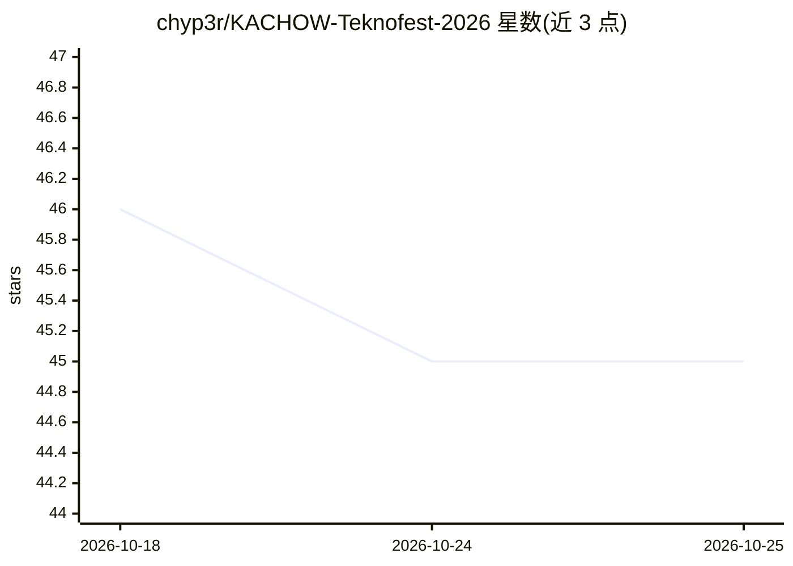

# chyp3r/KACHOW-Teknofest-2026

⭐ 45 · Python · Apache-2.0 · 推送 2026-08-28 · [GitHub](https://github.com/chyp3r/KACHOW-Teknofest-2026) · [官网](https://chyp3r.github.io/KACHOW-Teknofest-2026/) · 组织维护

**面向公共机构的土耳其语公文多智能体分析与起草平台**

TEKNOFEST 2026 参赛项目：LangGraph 多智能体系统，读取上传公文后执行类型识别、字段抽取、缺失信息标记、法规检索（BM25+dense 混合检索，mevzuat-mcp 或本地语料回退）、公文起草、来源核验（日期/金额/机构等与原文比对）与机构路由建议；关键节点经 Human-in-the-Loop 中断并从 PostgreSQL checkpoint 恢复。含 RBAC+ABAC 多租户、RLS 隔离、输入输出 Guardrail；可选从用户反馈提取偏好对做 SFT/LoRA/DPO 机构风格适配。支持 Ollama 本地模式与 Evren API 服务器模式切换。

## 筛选速览

| 维度 | 判定 | 备注 |
|---|---|---|
| AI 角色 | `ai-native` | 本体是模型或模型工具 |
| 许可风险 | `permissive` | Apache-2.0 |
| 部署形态 | `self-host` | docker 或自建部署 |
| 模型依赖 | local-ok | 支持本地模型 |
| 硬件要求 | `gpu-8g` | |
| 安装摩擦 | `low` | 无编译、无系统依赖或容器化 |
| 成熟度 | — | 结构信号不足 |

## 能力要点

- LangGraph 多节点流水线：分析→法规检索→起草→核验→路由→人工批准
- 双模式运行：Ollama+本地 Qdrant 封闭网络模式或 Evren API 服务器模式
- 多租户 PostgreSQL RLS 隔离与 RBAC+ABAC、PII/提示注入等 Guardrail
- 基于用户反馈的机构风格学习（≥50 样本触发，可选 LoRA/DPO 训练 worker）

## 适用场景

- 公共机构公文自动分析与官方回复起草
- 公文流转中按内容推荐承办单位并附理由
- 要求人工审批与数据不出内网的政府文档处理

## 场景标签

`多智能体` `微调` `文档问答` · 领域:Agent 开发

## 证据(README 行号)

> L3: **Kamu kurumlarındaki resmî evrak süreçlerini yapay zekâ desteğiyle analiz eden, taslak oluşturan, doğrulayan ve doğ
> L5: TEKNOFEST 2026 · LangGraph tabanlı çok-ajan mimarisi · İnsan onaylı karar akışları · Türkçe resmî yazışma otomasyonu
> L88: 5. resmî yazışma taslağı oluşturur,

## 星数曲线

2026-10-18 46 → 2026-10-25 45（-1）

---
*卡片 v1 · prompt 1.4 · 生成 2026-10-25 · 置信度 high · 依据 README sha `535ab04f3b75` · [字段定义](../../DATASET.md)*
