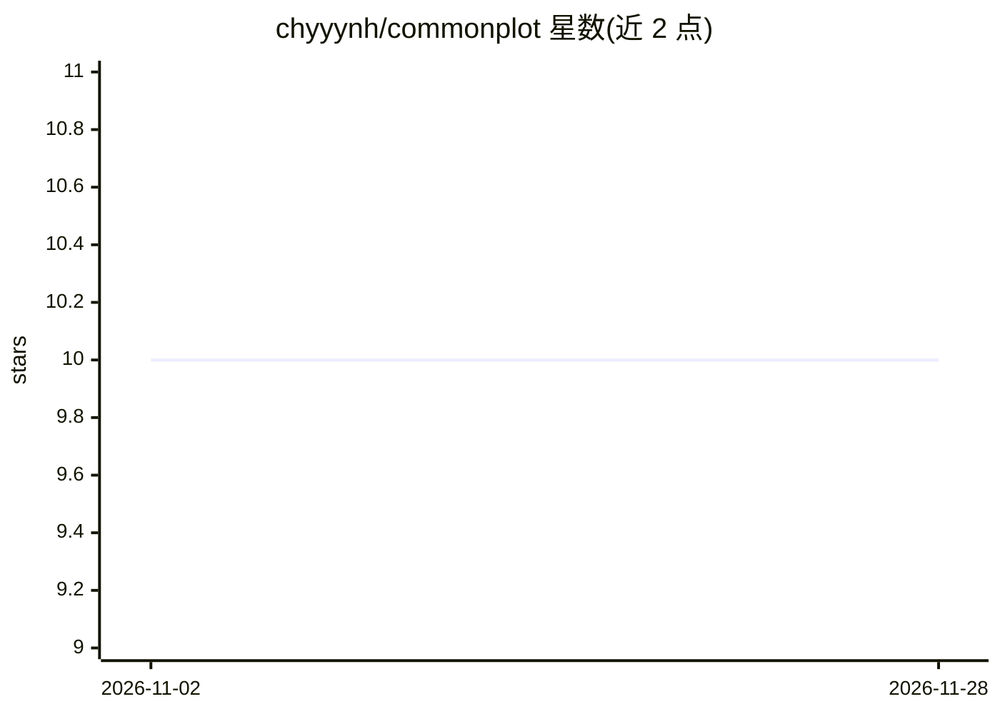

# chyyynh/commonplot

⭐ 10 · TypeScript · NOASSERTION · 推送 2026-11-01 · [GitHub](https://github.com/chyyynh/commonplot) · [官网](https://commonplot.co) · 个人维护

**把链接/订阅源/PDF 摄取为可读资源的引擎，供 Claude/ChatGPT 调用**

commonplot.co 背后的摄取引擎（core）：以 Cloudflare Worker 形式运行，每 5 分钟 cron 触发，把网页、RSS/Atom/JSON Feed、PDF、论文（DOI/arXiv/OpenAlex）、X/Twitter、YouTube、Hacker News、LessWrong 等来源解析为 Resource，写入 Postgres，并派生摘要、实体、翻译与搜索向量；后续任务通过 Workflow 与 Queue 独立重试。通过 MCP 服务器（commonplot.co/api/mcp）供 Claude 与 ChatGPT 插件调用。自托管需要 Cloudflare 账号、PostgreSQL 与 Docker，commonplot 应用本体未发布。

## 筛选速览

| 维度 | 判定 | 备注 |
|---|---|---|
| AI 角色 | `ai-enhanced` | 去掉 AI 部分产品仍成立 |
| 许可风险 | `none` | NOASSERTION |
| 部署形态 | `library` | 以包/库形式分发 |
| 模型依赖 | — | README 未给出锁定关系 |
| 硬件要求 | — | 无带数字的原话,不猜 |
| 安装摩擦 | `low` | 无编译、无系统依赖或容器化 |
| 成熟度 | — | 结构信号不足 |

## 能力要点

- 9 类来源适配（网页/PDF/论文/X/YouTube/HN/LessWrong/RSS）
- AI Gateway 派生摘要、实体、翻译，Workers AI 生成嵌入
- 论文身份解析经 OpenAlex/Crossref 获取元数据与开放获取全文
- 对外提供 MCP 服务器与 Claude/ChatGPT 插件

## 适用场景

- 持续监视 RSS、YouTube、X 等来源并自动生成摘要与翻译
- 按 DOI/arXiv 导入论文并检索其参考文献
- 在 Claude 或 ChatGPT 中通过 MCP 检索已摄取的资源

## 场景标签

`科研工具` `文档解析` `网页抓取` · 领域:效率与自动化

## 证据(README 行号)

> L11: A Cloudflare Worker that turns links, feeds and uploaded PDFs into readable
> L109: |`AI`|AI Gateway (summaries, translations) and Workers AI embeddings|

## 星数曲线

2026-11-02 10 → 2026-11-28 10（+0）

---
*卡片 v1 · prompt 1.4 · 生成 2026-11-19 · 置信度 mid · 依据 README sha `2a24f038972f` · [字段定义](../../DATASET.md)*
