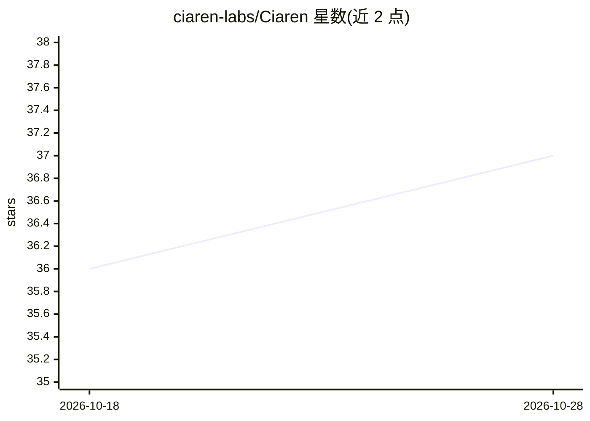

# ciaren-labs/Ciaren

⭐ 37 · Python · AGPL-3.0 · 推送 2026-10-28 · [GitHub](https://github.com/ciaren-labs/Ciaren) · [官网](https://ciaren.com) · 个人维护

**本地优先的可视化 ETL 与数据/ML 流水线构建器，可导出 Python 代码**

开源、本地优先的可视化 ETL 与低代码数据流水线工具：在画布上拖拽节点完成数据加载、清洗、联结、校验与转换，训练轻量机器学习模型，并调度运行；每个节点支持实时预览，流水线可导出为独立可运行的 pandas / Polars / lazy Polars 脚本或 Jupyter notebook，无专有运行时。面向数据分析师、数据工程师与 ML 从业者，支持插件扩展（自定义节点、连接器、模型类型）。以 pip 安装（wheel 内置 React 编辑器）、Docker Compose 或源码运行，SQLite 开箱即用。当前为 Alpha 阶段，1.0 前 API 与数据模型可能变更。

## 筛选速览

| 维度 | 判定 | 备注 |
|---|---|---|
| AI 角色 | `ai-enhanced` | 去掉 AI 部分产品仍成立 |
| 许可风险 | `viral` | AGPL-3.0 |
| 部署形态 | `self-host` | docker 或自建部署 |
| 模型依赖 | — | README 未给出锁定关系 |
| 硬件要求 | — | 无带数字的原话,不猜 |
| 安装摩擦 | `low` | 无编译、无系统依赖或容器化 |
| 成熟度 | `idea` | |

## 能力要点

- 拖拽式画布构建数据与 ML 流水线，节点级实时预览
- 导出独立 pandas / Polars / lazy Polars 脚本与 Jupyter notebook，无专有运行时
- 本地优先执行（SQLite 开箱即用），数据不必离开本机
- 插件架构支持自定义节点、连接器与 ML 模型类型（.ciarenplugin 包）

## 适用场景

- 不写代码地完成数据清洗、转换与校验，并导出可审查的 Python 脚本
- 在单机上原型化可重复运行的本地数据流水线，再用 CLI/API/SDK 自动化
- 在画布上训练和评估轻量 ML 模型并跟踪 MLflow 指标

## 场景标签

`工作流自动化` · 领域:效率与自动化

## 证据(README 行号)

> L40: Ciaren is an open-source, local-first **visual ETL tool** and **low-code data
> L145: - **Machine learning:** split, train, cross-validate, predict, evaluate,

## 星数曲线

2026-10-18 36 → 2026-10-28 37（+1）

---
*卡片 v1 · prompt 1.4 · 生成 2026-10-25 · 置信度 mid · 依据 README sha `d1db361e030c` · [字段定义](../../DATASET.md)*
