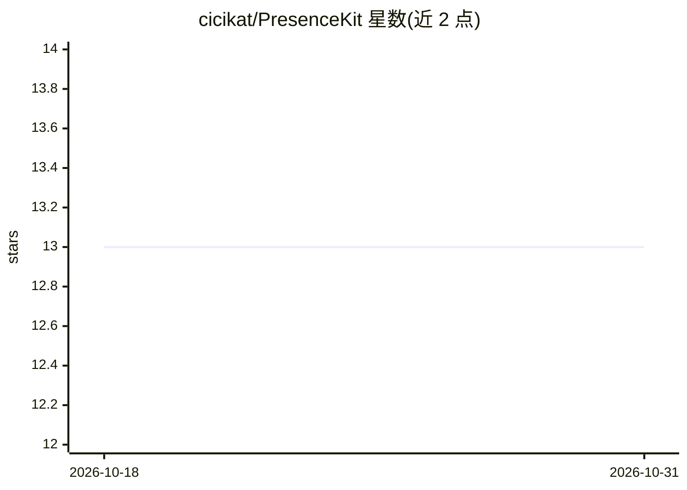

# cicikat/PresenceKit

⭐ 13 · Python · NOASSERTION · 推送 2026-10-25 · [GitHub](https://github.com/cicikat/PresenceKit) · 个人维护 · 中文 README

**单人 AI 伴侣后端运行时：人格、长期记忆、情绪与主动联系**

面向单用户的本地/受保护局域网 AI 伴侣后端，集中管理人设、多层长期记忆（短中期/情景/身份/向量/剧情线等十余层）、情绪、工具、主动联系调度与隔离的 Dream 运行时。桌面端与移动端为瘦客户端，仅负责渲染与采集，不持有记忆与人格。支持 QQ（NapCat/OneBot 11）与 HTTP/WebSocket 多通道，提供管理面板做配置与观测；多预设模型路由（DeepSeek/OpenAI/Anthropic 兼容/本地），自带 API key，敏感能力默认关闭。

## 筛选速览

| 维度 | 判定 | 备注 |
|---|---|---|
| AI 角色 | `ai-native` | 本体是模型或模型工具 |
| 许可风险 | `none` | NOASSERTION |
| 部署形态 | `library` | 以包/库形式分发 |
| 模型依赖 | — | README 未给出锁定关系 |
| 硬件要求 | — | 无带数字的原话,不猜 |
| 安装摩擦 | `low` | 无编译、无系统依赖或容器化 |
| 成熟度 | `idea` | |

## 能力要点

- 后端独占记忆/人格/调度，客户端为瘦客户端的单一事实源架构
- 十余层并行记忆结构，遗忘为降级/墓碑而非物理删除
- 主动联系走 fact signal → autonomy 评估 → talk_owner 门控链路
- Reality/Dream 双隔离域，Dream 仅薄回写、不入真实事件

## 适用场景

- 在本地或局域网自托管一个拥有长期记忆的 AI 伴侣
- 通过 QQ、桌面宠物或手机客户端与同一角色持续对话
- 让伴侣基于日记、传感器、日程等事实信号主动发起联系

## 场景标签

`Agent 记忆` `聊天机器人` · 领域:Agent 开发

## 证据(README 行号)

> L5: A **single-user AI companion backend**. It owns persona, long-term memory, mood, tools, proactive contact, and an is
> L40: - A single-owner local or protected-LAN companion runtime: one process, one `scheduler.owner_id`, one set of cards 
> L90: - Multi-preset routing: DeepSeek / OpenAI Chat Completions / Responses / Anthropic-compatible / local. Profiles map

## 星数曲线

2026-10-18 13 → 2026-10-31 13（+0）

---
*卡片 v1 · prompt 1.4 · 生成 2026-10-31 · 置信度 mid · 依据 README sha `46236ff40d7a` · [字段定义](../../DATASET.md)*
