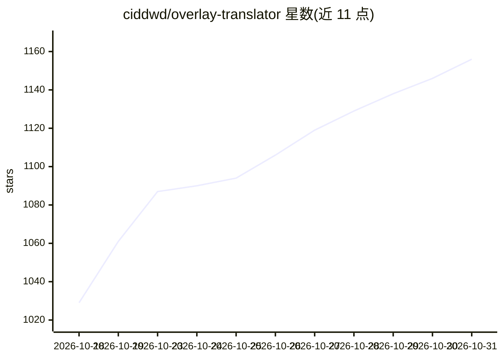

# ciddwd/overlay-translator

⭐ 1,156 · Kotlin · Apache-2.0 · 推送 2026-10-30 · [GitHub](https://github.com/ciddwd/overlay-translator) · 个人维护 · 中文 README

**无需 ROOT 的 Android 屏幕实时翻译工具，覆盖游戏/漫画/视觉小说**

通过 MediaProjection 或 Shizuku 截屏，经端侧或云端 OCR（ML Kit、PaddleOCR、日漫 OCR、百度/腾讯/有道等）识别文字，再由 LLM 或机器翻译引擎译成目标语言，以悬浮窗叠加在原文上，并可用系统语音或在线 TTS 朗读。支持全离线运行（含 Sakura/Hy-MT2 端侧 LLM），也支持自建局域网 OCR 与语音服务。面向在手机上阅读外文游戏、漫画、视觉小说的用户，仅发布 arm64-v8a APK。

## 筛选速览

| 维度 | 判定 | 备注 |
|---|---|---|
| AI 角色 | `ai-native` | 本体是模型或模型工具 |
| 许可风险 | `permissive` | Apache-2.0 |
| 部署形态 | `None` |  |
| 模型依赖 | local-ok | 支持本地模型 |
| 硬件要求 | — | 无带数字的原话,不猜 |
| 安装摩擦 | `medium` | 含编译或系统依赖之一 |
| 成熟度 | — | 结构信号不足 |

## 能力要点

- 截屏→OCR→翻译→叠加显示→TTS 朗读各环节可独立配置，可全离线运行
- 端侧 OCR 含 ML Kit、PaddleOCR v5/v6、日漫 OCR（manga-ocr ONNX）
- 翻译支持 DeepSeek/ChatGPT/Claude 等 OpenAI/Anthropic 兼容 LLM 与端侧 Sakura/Hy-MT2
- 漫画气泡检测、竖排日漫识别、按 App 保存术语与译法库

## 适用场景

- 玩外文游戏或视觉小说时实时把译文盖在原文上
- 阅读日文/韩文漫画时按气泡形状替换并翻译文字
- 划词查生词并让 AI 给出完整字典释义
- 批量翻译相册中的截图与漫画图片

## 场景标签

`OCR` `语音合成` · 领域:内容生成

## 证据(README 行号)

> L17: 通过 MediaProjection / Shizuku 截屏 → 端侧或云端 OCR → LLM / 机器翻译 → 悬浮窗叠加显示。
> L57: - **大语言模型**：DeepSeek / ChatGPT / Claude / 智谱 / 自建服务……支持 OpenAI 或 Anthropic 兼容方式，一边翻一边显示

## 星数曲线

2026-10-18 1,029 → 2026-10-31 1,156（+127）

---
*卡片 v1 · prompt 1.4 · 生成 2026-10-21 · 置信度 high · 依据 README sha `c7138a05ce5f` · [字段定义](../../DATASET.md)*
