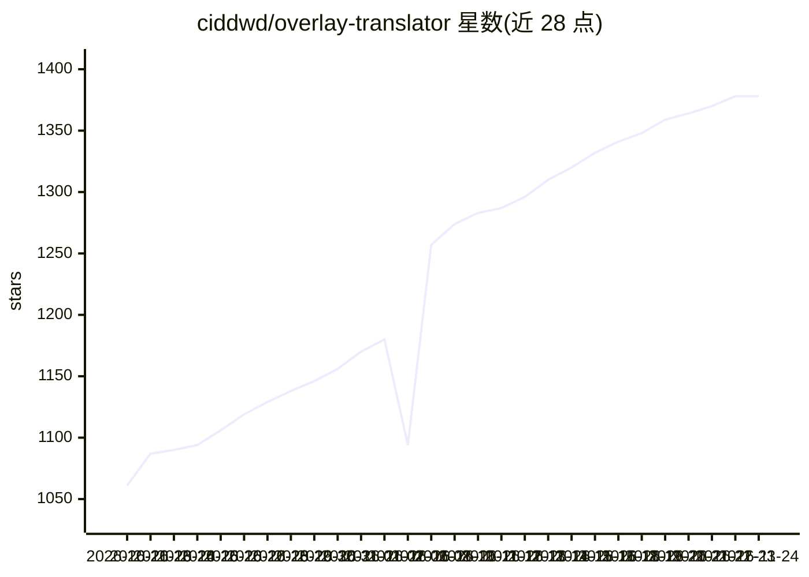

# ciddwd/overlay-translator

⭐ 1,390 · Kotlin · Apache-2.0 · 推送 2026-11-16 · [GitHub](https://github.com/ciddwd/overlay-translator) · 个人维护 · 中文 README

**给游戏/漫画/视觉小说用户的安卓无 ROOT 屏幕实时翻译工具**

安卓端实时屏幕翻译应用：通过系统截屏、Shizuku、无障碍或 Root 获取画面，经端侧或云端 OCR 识别文字，再用 LLM 或机器翻译引擎翻译，译文以悬浮窗叠加显示；还支持相册图片批量翻译、视频语音双语字幕和划词字典。可全离线运行（本地 OCR + 本地翻译模型 + 系统语音），也可接入多种云服务。从 Releases 下载 APK 安装，目前仅发布 arm64-v8a 架构，最低 Android 8.0，代码采用 Apache-2.0。

## 筛选速览

| 维度 | 判定 | 备注 |
|---|---|---|
| AI 角色 | `ai-native` | 本体是模型或模型工具 |
| 许可风险 | `permissive` | Apache-2.0 |
| 部署形态 | `None` |  |
| 模型依赖 | local-ok | 支持本地模型 |
| 硬件要求 | — | 无带数字的原话,不猜 |
| 安装摩擦 | `medium` | 含编译或系统依赖之一 |
| 成熟度 | — | 结构信号不足 |

## 能力要点

- 无 ROOT 截屏 + 端侧 OCR（ML Kit/PaddleOCR/manga-ocr）可完全离线
- 本地翻译模型支持 llama.cpp GGUF 导入与 Sakura/Qwen 等系列
- 漫画场景：竖排识别、气泡检测擦除原文并按气泡排版译文
- 视频实时语音识别生成双语字幕，本地可选 SenseVoice/Zipformer/Whisper

## 适用场景

- 玩日文游戏或视觉小说时，点悬浮球即时翻译屏幕对话
- 看竖排日漫，译文自动贴进气泡并擦除原文
- 给无字幕的外语视频生成实时双语字幕
- 把玩过的生词框选出来，用 LLM 查音标、例句和释义

## 场景标签

`语音识别` `OCR` `图像视频处理` · 领域:感知与多模态

## 证据(README 行号)

> L17: **无需 ROOT，最低支持 Android 8.0，单机可用**，支持视觉小说、漫画、游戏对话等任意屏上文字翻译，以及视频语音实时翻译与双语对照字幕（视频翻译需要 Android 10 或更高版本）。
> L19: 通过系统截屏、Shizuku、无障碍或 Root 获取画面 → 端侧或云端 OCR → LLM / 机器翻译 → 悬浮窗叠加显示。
> L70: - **大语言模型**：DeepSeek / ChatGPT / Claude / 智谱 / 自建服务……支持 OpenAI 或 Anthropic 兼容方式，一边翻一边显示
> L72: - **本机翻译**：Google ML Kit 下载语言包后可离线使用；本地模型管理支持 Sakura、Hy-MT2、Index-Translate、Qwen、LFM 和 Gemma 系列，也可导入 GGUF 文件，详见下方模型

## 星数曲线

2026-10-21 1,061 → 2026-11-24 1,378（+317）

---
*卡片 v1 · prompt 1.4 · 生成 2026-11-23 · 置信度 high · 依据 README sha `12b413f93f52` · [字段定义](../../DATASET.md)*
