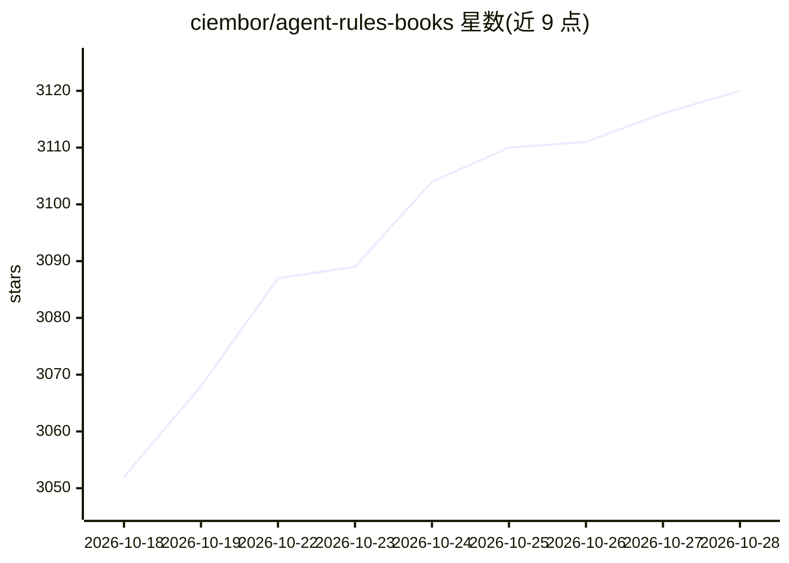

# ciembor/agent-rules-books

⭐ 3,120 · MIT · 推送 2026-09-10 · [GitHub](https://github.com/ciembor/agent-rules-books) · [官网](https://ciembor.github.io/agent-rules-books/) · 个人维护

**从 14 本软件工程书籍提炼的 AI 编程 agent 规则/技能集**

面向 Codex、Cursor、Claude Code、GitHub Copilot 等 AI 编程 agent 的 AGENTS.md 规则与技能包：从 Clean Code、DDD、DDIA、Refactoring 等 14 本书提炼工程指令，每套规则提供 mini/nano/full 三种 Markdown 版本，目录含 SKILL.md 入口，可通过 npx skills CLI 按需安装。附验证实验：mini 规则重构获 ChatGPT 约 74/100 评分，对照仅提及书名的 46/100，作者自述为早期定性信号而非基准。规则为原创工程指令，不复制书文。

## 筛选速览

| 维度 | 判定 | 备注 |
|---|---|---|
| AI 角色 | `ai-knowledge` | 知识聚合/清单类 |
| 许可风险 | `permissive` | MIT |
| 部署形态 | `library` | 以包/库形式分发 |
| 模型依赖 | — | README 未给出锁定关系 |
| 硬件要求 | — | 无带数字的原话,不猜 |
| 安装摩擦 | `low` | 无编译、无系统依赖或容器化 |
| 成熟度 | `idea` | |

## 能力要点

- 14 本书源规则集，每套提供 mini/nano/full 三种版本
- npx skills CLI 一键安装全部或指定技能
- 包含 SKILL.md 标准 agent skills 入口
- 以对照实验报告规则集效果（自述为早期定性信号）

## 适用场景

- 为我的编程 agent 配置架构、重构或遗留代码处理规则
- 给 Claude Code / Cursor / Codex 项目添加 AGENTS.md 约束
- 上下文紧张时选 nano 版规则控制 token 预算

## 场景标签

`提示工程` · 领域:Agent 开发

## 证据(README 行号)

> L7:  AGENTS.md rules / skills for Codex , Cursor , Claude Code , distilled from classic software engineering books about
> L28: Each rule set is released in three tool-agnostic Markdown versions:

## 星数曲线

2026-10-18 3,052 → 2026-10-28 3,120（+68）

---
*卡片 v1 · prompt 1.4 · 生成 2026-10-20 · 置信度 high · 依据 README sha `3d61d10c62e1` · [字段定义](../../DATASET.md)*
