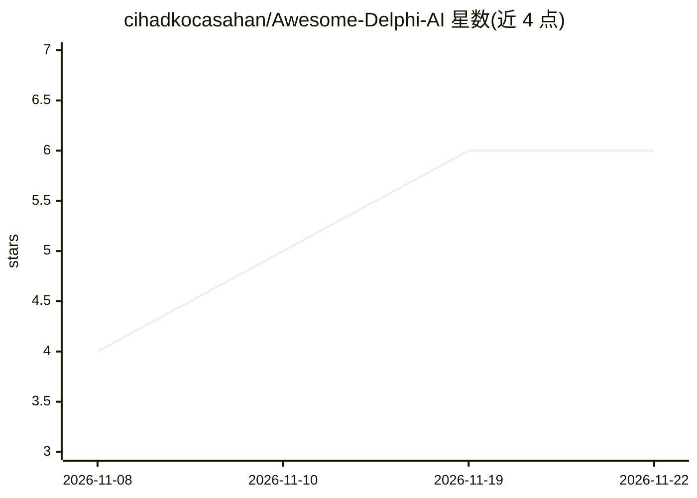

# cihadkocasahan/Awesome-Delphi-AI

⭐ 6 · 推送 2026-11-18 · [GitHub](https://github.com/cihadkocasahan/Awesome-Delphi-AI) · [官网](https://github.com/cihadkocasahan/Awesome-Delphi-AI) · 个人维护 · 中文 README

**面向 Delphi 开发者的 AI 工具与 MCP 服务器目录清单**

按类别组织的 Delphi/Object Pascal AI 生态资源目录，收录 MCP 服务器、LSP 实现、AST 解析器、RAG 引擎、LLM 客户端库、agent 框架与 IDE 插件等条目，每条附简介与标签。目录定期扫描更新，聚焦 Delphi 开发体验（DevEx）与工程工作流的现代化，支持英文与土耳其语双语页面。

## 筛选速览

| 维度 | 判定 | 备注 |
|---|---|---|
| AI 角色 | `ai-knowledge` | 知识聚合/清单类 |
| 许可风险 | `none` | — |
| 部署形态 | `desktop` | 安装包/桌面程序 |
| 模型依赖 | — | README 未给出锁定关系 |
| 硬件要求 | — | 无带数字的原话,不猜 |
| 安装摩擦 | `high` | 编译与系统依赖俱全 |
| 成熟度 | — | 结构信号不足 |

## 能力要点

- 收录 Delphi 原生 MCP 服务器实现与 IDE/编译器/调试器的 agent 工具
- 覆盖 LSP 实现、AST 解析、RAG 代码检索等开发工具类别
- 包含 Delphi/FreePascal 的 LLM 客户端库与 ONNX 推理封装
- 双语（英/土）页面，定期扫描更新

## 适用场景

- 为 Delphi 项目查找可接入 Claude Code/Cursor 的 MCP 服务器
- 寻找 Object Pascal 的 LLM 客户端或向量/RAG 库
- 了解 Delphi AI 开发工具生态的最新开源项目

## 场景标签

`精选清单` · 领域:学习与行业

## 证据(README 行号)

> L5: > A comprehensive open-source directory and catalog of tools, libraries, MCP servers, LSP implementations, and AI-dr
> L7: > 🔍 **Community-Curated:** Periodically scanned and updated to include the latest open-source Delphi AI projects.

## 星数曲线

2026-11-08 4 → 2026-11-22 6（+2）

---
*卡片 v1 · prompt 1.4 · 生成 2026-11-20 · 置信度 high · 依据 README sha `924e2ef093c8` · [字段定义](../../DATASET.md)*
