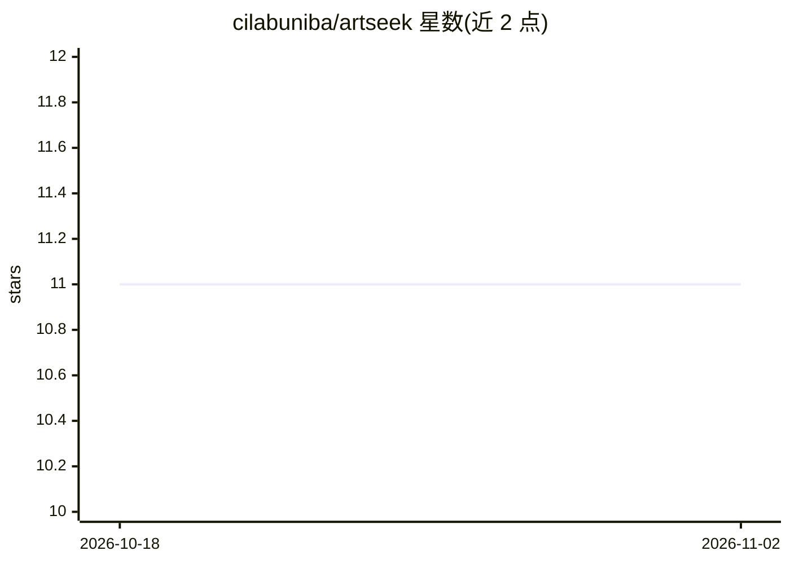

# cilabuniba/artseek

⭐ 11 · Jupyter Notebook · MIT · 推送 2026-10-21 · [GitHub](https://github.com/cilabuniba/artseek) · [官网](http://cilab.di.uniba.it/artseek/) · 组织维护

**WACV 2027 论文系统：多模态检索增强的 artwork 理解与问答**

巴里大学团队的 WACV 2027 接收项目，回答关于艺术品的开放式问题：多模态 LLM（Qwen2.5-VL-32B，零样本）查看画作，读取属性分类器 LICN 生成的 artwork card，通过 in-context 工具调用决定何时从 WikiFragments（820 万 Wikipedia 片段，ColQwen2 late interaction 检索，Qdrant 存储）检索外部知识后再作答。提供 Streamlit 交互演示与论文复现脚本。运行需单张 64GB NVIDIA GPU、128GB 内存、约 1TB 磁盘，Linux + Python 3.12，全流程搭建约一天。

## 筛选速览

| 维度 | 判定 | 备注 |
|---|---|---|
| AI 角色 | `ai-native` | 本体是模型或模型工具 |
| 许可风险 | `permissive` | MIT |
| 部署形态 | `desktop` | 安装包/桌面程序 |
| 模型依赖 | local-ok | 支持本地模型 |
| 硬件要求 | — | 无带数字的原话,不猜 |
| 安装摩擦 | `low` | 无编译、无系统依赖或容器化 |
| 成熟度 | — | 结构信号不足 |

## 能力要点

- WikiFragments 多模态知识库：820 万片段，ColQwen2 late interaction 检索
- 两阶段检索：仅保留文本 token 预取，成本低于全量多向量检索的 7%
- LICN 晚交互分类器：预测艺术家/流派/风格/媒介/标签生成 artwork card
- in-context 工具调用：单个示例教 Qwen2.5-VL-32B 分步决定何时检索

## 适用场景

- 对艺术品图像提问并获得带检索依据的开放性回答
- 复现论文的检索、分类与问答评测
- 在此基础上研究多模态 RAG 与晚交互检索方法

## 场景标签

`RAG` `多模态` · 领域:知识与检索

## 证据(README 行号)

> L20: ArtSeek answers open-ended questions about artworks. Given an image and a question, a multimodal LLM looks at the p
> L24: - **WikiFragments**, a multimodal knowledge base: 8.2M fragments (a paragraph plus the images above it, rendered as
> L27: - **In-context tool calling**: a single worked example teaches Qwen2.5-VL-32B when and what to retrieve, over sever

## 星数曲线

2026-10-18 11 → 2026-11-02 11（+0）

---
*卡片 v1 · prompt 1.4 · 生成 2026-11-02 · 置信度 mid · 依据 README sha `34d5ee5b9e05` · [字段定义](../../DATASET.md)*
