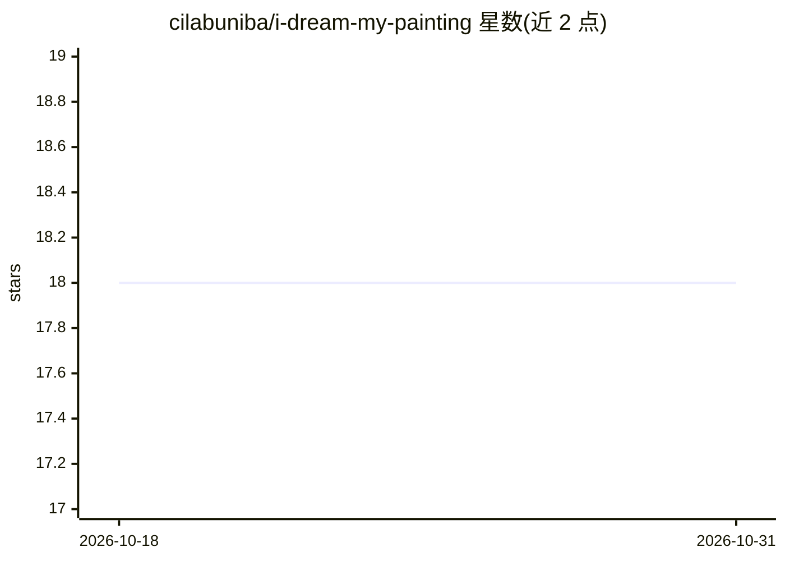

# cilabuniba/i-dream-my-painting

⭐ 18 · Jupyter Notebook · MIT · 推送 2025-12-29 · [GitHub](https://github.com/cilabuniba/i-dream-my-painting) · [官网](https://cilabuniba.github.io/i-dream-my-painting/) · 组织维护

**文本引导多掩码图像修复：MLLM 生成提示词驱动扩散模型**

WACV 2025 论文的参考实现：用 LLaVA 系列多模态模型（LLaVA-MultiMask）对多个掩码区域生成对象级描述作为提示词，再驱动 Stable Diffusion 2 Inpainting（RCA 微调版）完成文本引导多掩码修复。提供数据集构建流水线（Kosmos-2 全图标注 + LLaVA 对象级标注、WikiArt 约 11.6 万图）、模型权重下载、Colab 演示 notebook 与 accelerate 训练/测试命令。限制：原版 SD 2.1 官方权重已不可用，替代社区权重未经测试；需 CUDA≥12.1 环境。

## 筛选速览

| 维度 | 判定 | 备注 |
|---|---|---|
| AI 角色 | `ai-native` | 本体是模型或模型工具 |
| 许可风险 | `permissive` | MIT |
| 部署形态 | `library` | 以包/库形式分发 |
| 模型依赖 | — | README 未给出锁定关系 |
| 硬件要求 | — | 无带数字的原话,不猜 |
| 安装摩擦 | `medium` | 含编译或系统依赖之一 |
| 成熟度 | — | 结构信号不足 |

## 能力要点

- LLaVA 提示词生成 + SD-2 Inpainting 的两阶段多掩码修复流水线
- 提供 Kosmos-2 与 LLaVA 预生成标注及 WikiArt 数据集构建脚本
- 报告 Accuracy/BLEU/ROUGE-L/CLIPSim 的多组实验结果并给出复现命令

## 适用场景

- 复现论文中的多掩码文本引导图像修复实验
- 构建带对象级标注的艺术图像修复数据集
- 基于 LLaVA 与 Stable Diffusion 训练自己的修复/提示词生成模型

## 场景标签

`图像生成` `图像视频处理` `微调` · 领域:内容生成

## 证据(README 行号)

> L3: This repository contains the reference code for the paper "I Dream My Painting: Connecting MLLMs and Diffusion Model
> L99:     python -m inpainting.data.ops caption-masks --entities-dir data/mm_inp_dataset/entities --model-id llava-hf/lla
> L133: To use our **multi-mask inpainting** model, you need to clone the `stabilityai/stable-diffusion-2-inpainting` mode

## 星数曲线

2026-10-18 18 → 2026-10-31 18（+0）

---
*卡片 v1 · prompt 1.4 · 生成 2026-10-29 · 置信度 mid · 依据 README sha `81c56719aa31` · [字段定义](../../DATASET.md)*
